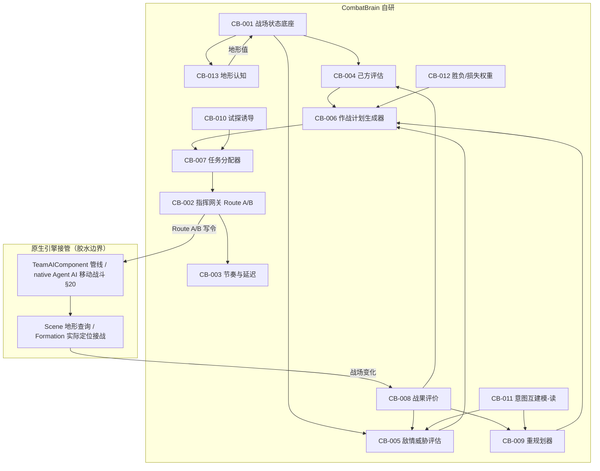

# CombatBrain 2.0 功能拆解设计规格（总设计师）

> 文档性质：设计规格（供文书专员据此落笔为正式草案）。
> 单一信息源：Charter V0.2.md。研究依据：r1-code-analyst / r1-glue-engine / r1-rbm / r1-cb-legacy。
> 证据标记：`[已验证]`=源报告已逐字/运行期确认；`[推断]`=基于宪章与已知 API 的设计推导；`[待实测]`=需实机核验。

---

## 0. 设计立场：本设计如何服从宪章

本设计在落笔前先锁定四条不可逾越的红线，任何 CB-00X 若冲撞红线即判定"不该进范围"（§21）：

1. **通用机制优先，不为具体情形加专用规则链（§26）**。所有高级战场行为（试探、弱点利用、战果扩大、损失控制、反制、重规划）必须优先由"共享战场状态 + 统一评价 + 作战计划 + 任务分配 + 反馈"少量机制组合产生。新增独立战术系统 / 规则链，仅在证明现有统一机制无法合理表达时才允许，且须重新过 §21 四问。
2. **绝不进入单兵 Agent 行为层（§19、§20）**。CombatBrain 只决定 Formation 去哪、承担何任务；具体 Agent 如何战斗交给原生 AI。凡触达 `GetOrderPositionOfUnit`、个体格挡、选靶、姿态数值联动者，一律不进范围。
3. **不靠数值加成 / 隐藏 Buff / 玩家不可得的隐藏信息（§3、§14）**。AI 优势只能来自决策能力。信息公平落地为"读公开 `QuerySystem` / `Team` 属性"，与 RTS 指挥视角等价；不造视野遮挡、不造迷雾。
4. **必须有决策节奏与指挥延迟（§16）**，且须可审计；范围冻结（§21），代号不继承旧的 T/F/X（旧专报结论），保留 CPS/ATC 治理代号作为 2.0 基座。

**复用纪律**：旧模组 / 旧版 / RBM 的资产不因为"已经存在"就复用。"工程基建"（日志、数学、几何聚合、事件总线、对象池、离线测试、Harmony 模板、ilscan）可复用；"逻辑/单兵层/专用情形规则链/迷雾/拟人抖动"经新宪章审核后**明确不复用**。

**终极目标锚定**：本设计一切功能最终服务于"具备实际取胜能力的战场指挥 AI"（§2、§3）与"玩家与 AI 的持续战术博弈"（§4），而非增加战术脚本数量或阵型复杂度。

---

## 1. 核心约束摘要（引擎权限边界，来自胶水设计师）

胶水设计师已确认第一性约束，本设计全部架构建立其上：

- **AI 队伍没有、也不拥有 `OrderController`**。全引擎唯一发令接口 `Team.PlayerOrderController` 仅玩家队可用。AI 队 Formation 指令只有两条路：
  - **Route A（软注入）**：自定义 `BehaviorComponent` / `TacticComponent` 经 `FormationAI.AddAiBehavior` + `SetBehaviorWeight`（或 `Team.AddTacticOption`）塞进原生 `TeamAIComponent` 决策管线，靠 `GetAiWeight` 提权让引擎自己"选中"我们。仅表达 **Movement 域**；Facing/Arrangement 不走 Behavior。
  - **Route B（硬接管）**：`Formation.SetControlledByAI(false)` 关原生 AI，主线程直接写 `SetMovementOrder`/`SetFacingOrder`/`SetArrangementOrder`/`SetFormOrder`/`SetFiringOrder`。三域皆控但需防原生覆盖与异步竞态。
  - **兜底 hybrid**：Route A 主路表达意图；仅"关键安全命令"用 Route B 短租约（TTL 1.25–1.5s、最短持有 1.0s、watchdog 到期 fail-open 自动归还、玩家接管立即释放）。

- **命令读写必须收敛到主线程 `OnMissionTick`**（胶水 §3、§4）。原生 `doAsyncAITick→TickOccasionally` 跑 worker 线程，在异步路径改编队命令会竞态崩溃。

- **胶水设计师列出的 7 条"不能做"**，本设计全部在 CB-002（指挥网关）与 CB-003（节奏/距离闸）内吸收解决，不存在某个 CB 被判定为"引擎不支持"而无法推进：
  1. 不能给 AI 队用 OrderController → Route A/B 替代；
  2. 不能获得玩家看不到的隐藏信息 → §14 本就禁止，只读公开查询；
  3. 不能改单兵攻击/格挡/选靶 → §20 边界，只控 Formation；
  4. 不能改原生每帧 agent 定位数学 → 经阵型几何与命令间接影响；
  5. 不能裸调 `SetArrangementOrder` 而不被覆盖 → Route A/B；
  6. 不能从 worker/async 线程安全改编队命令 → 主线程 `OnMissionTick`；
  7. 原生无剧场效应 → 自实现距离闸（CB-003）。

---

## 2. 架构总图

### 2.1 ASCII 分层图（任何渲染环境可读）

```
┌──────────────────────────────────────────────────────────────────────┐
│                   CombatBrain 2.0 指挥决策栈（服务 §27 循环）            │
├──────────────────────────────────────────────────────────────────────┤
│ ① 认知层 Cognition —— CombatBrain 自研                                │
│    CB-001 战场状态底座 | CB-013 地形站位认知 | CB-011 意图互建模(读侧)   │
│         ↓ 共享战场状态 BattleState（friendly / enemy / field 三类）      │
│ ② 评价层 Evaluation —— CombatBrain 自研                               │
│    CB-004 己方能力评估 | CB-005 敌情威胁评估 | CB-008 战果评价          │
│    CB-012 胜负/损失权重                                                 │
│         ↓ 取胜方式 / 威胁 / 价值 / 正负反馈信号                         │
│ ③ 规划层 Planning —— CombatBrain 自研                                 │
│    CB-006 作战计划生成器 | CB-009 重规划器 | CB-010 试探与弱点诱导       │
│         ↓ 统一作战计划 Plan（objective + 任务 + 继续/终止条件）          │
│ ④ 任务分配层 Task Assignment —— CombatBrain 自研                      │
│    CB-007 任务分配器（保护/输出/牵制/突破/支援/预备/扩大战果 §23）       │
│         ↓ Formation 任务提案 TaskProposal                               │
│ ⑤ 执行层 Execution —— CombatBrain 写令 + 原生引擎接管〔胶水边界〕      │
│    CombatBrain 侧：CB-002 指挥网关(Route A/B) | CB-003 节奏与延迟        │
│         │  Route A：注入 BehaviorComponent / TacticComponent（仅 Movement）│
│         │  Route B：SetControlledByAI(false)+Set*Order（窄保险丝短租约） │
│    ── ── 胶水分界：原生引擎接管 ── ── ── ── ── ── ── ── ── ── ── ── ── │
│    原生侧：TeamAIComponent 管线 | native Agent AI 移动/战斗（§20）      │
│            | Scene 地形查询 | Formation 实际定位/阵型/接战               │
│         ↓ 实际战场变化                                                   │
│ ⑥ 反馈层 Feedback —— CombatBrain 自研                                │
│    CB-008 观察战果 | CB-011 观察玩家反应 ──→ 回灌 ① 认知层             │
└──────────────────────────────────────────────────────────────────────┘
         ▲                                                              │
         └──────────── §27 决策循环持续回流（直至战斗结束）──────────────┘
```

> 关键标注：①~④ 与 ⑥ 全为 CombatBrain 自研；⑤ 的"写令"侧自研、"执行/移动/战斗"侧为原生引擎接管（胶水层）。单兵 Agent 战斗行为（§20）完全在原生侧，不在本栈内。

### 2.2 Mermaid 版（标出自研 / 原生接管）



---

## 3. 阶段划分总表

| Stage | CB-00X | 一句话职责 | 落地性 | 难度 | 依赖 |
|---|---|---|---|---|---|
| **S1 基础底座** | CB-001 | 统一共享战场状态（己/敌/战场） | 可落地 | 低 | — |
| | CB-002 | 指挥执行网关（Route A/B + 唯一仲裁 + 硬门） | 受限落地 | 高 | CB-001 |
| | CB-003 | 决策节奏 + 指挥延迟控制器 | 可落地 | 中 | CB-002 |
| **S2 决策闭环** | CB-004 | 己方作战能力 / 取胜方式评估 | 可落地 | 中 | CB-001 |
| | CB-005 | 敌情与威胁 / 有意义目标评估 | 可落地 | 中 | CB-001 |
| | CB-006 | 统一作战计划生成器（Plan 一等对象） | 可落地 | 高 | CB-004/005 |
| | CB-007 | 任务分配器（§23 七类任务） | 可落地 | 高 | CB-006/002 |
| | CB-008 | 战果评价与正负反馈 | 可落地 | 中 | CB-001/002 |
| **S3 博弈深化** | CB-009 | 重规划器（持续验证计划有效性） | 可落地 | 高 | CB-006/008/003 |
| | CB-010 | 主动试探与弱点诱导 | 可落地 | 高 | CB-007/008/011 |
| | CB-011 | 敌我意图互建模（推测玩家方向） | 可落地(数据)/质量待实测 | 最高 | CB-001/005 |
| **S4 高级能力** | CB-012 | 胜负 / 损失 50-50 权重平衡 | 可落地 | 中 | CB-004/005/008 |
| | CB-013 | 地形与站位认知增强 | 受限落地 | 中 | CB-001 |

阶段依赖：S1 打通"能观察 + 能下达 + 有节奏"；S2 在 S1 之上闭合"能描述→能决策→能下达→能评价"最小环；S3 在闭环上加"能重规划 + 能博弈"；S4 补权衡与地形维度。

---

## 4. 功能详述（每个 CB-00X 含四硬项 + 落地性）

### CB-001 战场状态底座（认知层）
1. **功能简介与为什么**：建立统一的"共享战场状态"数据模型 `BattleState`，聚合己方 / 敌方 / 战场三类通用状态（兵力、兵种、Formation 位置、阵型、站位关系）。为什么现在做：§27 循环起点是"理解己方 / 理解敌方"，§26 要求所有模块共享统一战场状态表示，不得各算各的。不做会缺：后续评价 / 规划 / 反馈无统一数据源，必然退回旧版"各 Glue 各算各"的分裂（旧专报 ATC-4 四个 P0 即源于此）。
2. **如何服务宪章**：§5（己方结构认知）、§6（敌情认知）、§14（信息公平，用公开 `QuerySystem`）、§26（共享战场状态表示）、§27（理解己/敌为循环起点）。
3. **实现难度与建议**：**低**。复用 `SituationVector` 的 12 维归一化骨架，但重定义为"通用状态"而非单兵特征；复用 `TeamGeometry`（编队中心/队形聚合）、`CombatEventBus`（状态更新总线）、`VecMath`/`BufferPool`/`CombatLog` 基建。风险点：旧版 ATC-4 感知刷新失效 / 未知敌算已接敌 / 兵力算两遍——必须独立验证刷新逻辑，指标不可自证（旧专报核心警示）。
4. **复用审核**：`SituationVector` 骨架（中，重定义）、`TeamGeometry`（高，直接）、`CombatEventBus`（高）、`VecMath`/`BufferPool`/`CombatLog`（高）。**不复用** `KnowledgeView` / `VisibilityOracle`（违反 §14 迷雾）、任何单兵字段（违反 §20）。

**落地性：可落地**。`Formation.QuerySystem`、`Team`、`Formation` 公开属性（`CountOfUnits`/`Width`/`Direction`/`CurrentPosition` 等）均 `[已验证]` 可读取，RTS 等价。

---

### CB-002 指挥执行网关（执行层 · 落地关键）
1. **功能简介与为什么**：所有 Formation 指令的唯一出口，经 Route A/B 写 `Formation.Set*Order`，全收敛主线程 `OnMissionTick`，内置唯一仲裁与硬门（沿用 CPS/ATC 治理代号）。为什么现在做：§19/§20 边界必须有收口；§16 指挥延迟须可审计；旧版"命令互刷、后写者胜"直接催生冻结令，须唯一仲裁。不做会缺：上层任何决策都无法落地，且会与原生 AI 互相覆盖。
2. **如何服务宪章**：§8（Plan≠Command，执行是计划转化）、§16（指挥延迟 / 可审计）、§19（Formation 层指挥）、§20（止于编队指令不进单兵）、§27（按节奏执行）。
3. **实现难度与建议**：**高**。复用 CPS 控制面（唯一仲裁 + 硬门 GO）与 ATC 系列（并入 Plan/Commitment 语义）。实现：Route A 主路（自定义 `BehaviorComponent` 经 `FormationAI.AddAiBehavior`+`SetBehaviorWeight`，`GetAiWeight` 提权）；Route B 仅作窄保险丝（`SetControlledByAI(false)` 短租约 TTL 1.25–1.5s、fail-open 自动归还、玩家接管立即释放）。命令读写全收敛主线程。风险：原生 `OnBehaviorActivatedAux` 激活即重设全命令；异步 AI tick 竞态；`SetArrangementOrder` 0.5s 节流（意图变化才调用）。
4. **复用审核**：CPS 控制面（高，沿用为 2.0 基座）、ATC 系列（中，并入 Plan/Commitment）。**不复用** 旧各 Glue 的"靠调用顺序表达优先级"（催生冻结令，废弃）。

**落地性：受限落地**（全设计唯一关键受限点）。引擎不给 AI 队 OrderController `[已验证]`，已用 Route A/B 替代。Route B 在 `SetControlledByAI(false)` 后原生 Facing/Arrangement 是否仍覆盖 `[待实测]`——用 hybrid + fail-open 兜底；玩家 F6 接管 / 阵亡会改变 `IsAIControlled`，须监听 `OnFormationAIActiveBehaviorChanged` 边沿及时归还租约 `[推断]`。胶水 §5 的 7 条"不能做"在此模块全部吸收解决，不构成任何 CB 被判定"引擎不支持"。

---

### CB-003 决策节奏与指挥延迟控制器（执行层）
1. **功能简介与为什么**：用 `MissionTimer` + `CurrentTime` 做时间门控——高层规划每 N 秒一次、计划最小稳定时间、命令生成/传递延迟、各编队错峰响应。为什么现在做：§16 明确要求 Decision Cadence + Command Latency，且为玩家提供可利用的反制窗口（§4）。不做会缺：AI 表现为共享即时意识的同步反应，破坏博弈与公平性。
2. **如何服务宪章**：§16（决策节奏 + 指挥延迟）。
3. **实现难度与建议**：**中**。复用 `IntentEngine` 的 `hold_time`/`switch_margin` 机制（仅保留"计划最小稳定时间"语义，不是选战术）、`BehaviorLodScheduler` 的阈值 / 决策步长模型（去"剧场效应"包装，自实现距离闸）。风险：不要每帧调 `SetArrangementOrder`（0.5s 节流）。
4. **复用审核**：`IntentEngine` 机制（中）、`BehaviorLodScheduler`（中）。**不复用** `DecisionJitter`（违反 §15/§16，那是 agent 层拟人错误）。

**落地性：可落地**。`MissionTimer`/`CurrentTime` 为原生 `[已验证]`；距离闸自实现（原生无剧场效应 `[已验证]`，调参 `[待实测]`）。

---

### CB-004 己方作战能力评估（评价层）
1. **功能简介与为什么**：在 `BattleState` 之上识别己方兵力/兵种质量/各 Formation 职责/主要输出/关键保护/可突破牵制骚扰支援部队/主要优势与弱点，形成"当前最适合靠何种优势取胜"的高层判断。为什么现在做：§5 要求结构化己方认知且后续决策建立在该判断上；§27"判断取胜方式"。不做会缺：规划层无输入，决策退化为通用反应。
2. **如何服务宪章**：§5（己方态势认知）、§8（行动从属计划）、§18（胜负/损失权重输入）、§27。
3. **实现难度与建议**：**中**。复用 `TeamGeometry`。实现：把"优势/弱点/取胜方式"作为 `BattleState` 派生评价字段，而非独立规则链。风险：旧版 ATC-4"兵力算两遍 / 预备队误判"——须独立验证聚合。
4. **复用审核**：`TeamGeometry`（高）。**不复用** `FighterProfile`/单兵素质（违反 §20）。

**落地性：可落地**。纯逻辑，基于公开 Formation 属性 `[已验证]`。

---

### CB-005 敌情与威胁评估（评价层）
1. **功能简介与为什么**：分析敌军结构/部署/主要威胁/强势方向/薄弱方向/无保护关键单位，并识别"有意义目标"（参考 RBM `FindSignificantEnemy` 思想，但走通用价值评价而非写死兵种过滤）。为什么现在做：§6 敌情认知；§10 弱点利用输入；§27"理解敌方"。不做会缺：无法识别敌方薄弱与威胁，博弈无从谈起。
2. **如何服务宪章**：§6（敌情认知）、§10（弱点利用）、§14（信息公平，公开查询）、§27。
3. **实现难度与建议**：**中**。复用 `TeamGeometry`、`Formation.QuerySystem`（含 `ClosestSignificantlyLargeEnemyFormation`）。实现："有意义目标"作为通用价值权重，避免被小股勾走（参考 RBM 但通用化，呼应 §26）。风险：与 CB-004 共用刷新逻辑，防旧版感知 bug。
4. **复用审核**：`TeamGeometry`（高）、`QuerySystem`（高，公开）。**不复用** 旧 `OpponentModel` 实现（绑旧意图，仅概念参考）；**不复用** 写死兵种过滤（违反 §26）。

**落地性：可落地**。公开查询 RTS 等价 `[已验证]`。

---

### CB-006 作战计划生成器（规划层）
1. **功能简介与为什么**：据攻守身份/双方结构/兵力关系/战场态势/威胁/机会，形成统一作战方案 `Plan`，至少含：主要作战目标 / 主辅任务部队 / 重点保护 / 打开战局主力 / 继续条件 / 调整终止条件；并显式 `objective` 字段（供 §22 连贯性与可解释性锚点）。为什么现在做：§7 要求统一整体方案而非多个独立局部模块；§8 区分 Plan 与 Command；§27"形成计划"。不做会缺：旧版最大缺口 T25 多步计划零命中，决策无统一语义。
2. **如何服务宪章**：§7（统一作战方案）、§8（Plan≠Command）、§22（玩家识别整体意图，objective 为锚）、§27。
3. **实现难度与建议**：**高**，**新建无现成**。实现：`Plan` 为一等数据对象，所有任务引用同一 `objective`；继续/终止条件表达为可监测的战场谓词。风险：避免退回 `TacticManual` 的固定战术加权（违反 §26）。
4. **复用审核**：无逻辑复用；仅借 CPS/ATC 的 Plan/Commitment 语义雏形。**不复用** `TacticManual`（专用情形规则，违反 §26）。

**落地性：可落地**。纯决策逻辑，无引擎依赖，数据来自 CB-001/004/005。

---

### CB-007 任务分配器（任务分配层）
1. **功能简介与为什么**：把 `Plan` 转译为各 Formation 的 `TaskProposal`（保护/输出/牵制/突破/支援/预备/扩大战果，§23 枚举），取代旧 `TacticManual` 的 9 意图加权。为什么现在做：§23 要求所有 Formation 服务统一目标且职责可动态调整；§8 任务从属计划；§27"分配任务"。不做会缺：计划无法落到编队。
2. **如何服务宪章**：§23（兵种协同 / 任务型枚举）、§8、§27。
3. **实现难度与建议**：**高**，**新建**（取代 TacticManual）。实现：任务为通用语义，兵种不绑定永久职责；`TaskProposal` 经 CB-002 网关落地。风险：不与原生 Behavior 权重打架（须 Route A 提权或 Route B 租约）。
4. **复用审核**：复用 CB-002 网关、`X5` 阵型槽（通用站位，可沿用）。**不复用** `TacticManual`/`CavalryWaveFSM`/各专用 Glue（违反 §26/§23）。

**落地性：可落地（逻辑）/ 生效依赖 CB-002**。任务本身是数据结构；指令生效靠 CB-002 网关。

---

### CB-008 战果评价与反馈（评价层 + 反馈层）
1. **功能简介与为什么**：行动后评价战果，识别正向反馈（敌某方向削弱/阵型破坏/关键 Formation 失保护/士气降/反制减弱）与负向反馈（损失超预期/敌有效反制/关键条件不成立/执行单位受威胁/薄弱点已修复），触发扩大优势或控制损失。为什么现在做：§11 正向利用、§12 损失控制、§13 持续验证、§27"观察战果/判断正负反馈/扩大优势控制损失"。不做会缺：旧版反馈层最薄弱（T38/T39 缺口），行动完自动恢复静态。
2. **如何服务宪章**：§11（正向反馈利用）、§12（损失控制）、§13（重规划触发）、§27。
3. **实现难度与建议**：**中**。复用 `CombatEventBus`（反馈总线）、`ReplayRecorder`（决策回放，借鉴）。实现：以 `BattleState` 前后 diff + `Formation` 事件（`OnAfterArrangementOrderApplied` 等）作观察源；正负信号回灌评价层与规划层。风险：旧版 `OrderTrace` 把内部 `Record` 误标为"原生覆盖"、指标自证为伪——须独立验证。
4. **复用审核**：`CombatEventBus`（高）、`ReplayRecorder`（中，借鉴）。**不复用** 旧 F10 跨战役记忆（违反 §21 范围外，暂缓）。

**落地性：可落地**。观察源公开（Formation 事件 + 状态 diff）`[已验证]` 挂钩存在。

---

### CB-009 重规划器（规划层 + 反馈层）
1. **功能简介与为什么**：持续判断计划有效性（敌是否已反制 / 是否仍获预期收益 / 是否有更高价值新机会 / 是否必须优先处理新威胁），必要时重规划。为什么现在做：§13"任何计划不得永久有效"；§24 玩家行为驱动调整；§27"必要时重新规划"。不做会缺：AI 退化为"选初始战术→固定执行到结束"（§24 反面）。
2. **如何服务宪章**：§13（重新规划）、§24（按玩家行为调整）、§27。
3. **实现难度与建议**：**高**，**新建**。实现：重规划触发 = CB-008 正负信号或玩家行为显著变化（经 CB-011）且越过 CB-003 最小稳定时间；重规划复用 CB-006 生成器。风险：与 CB-003 节奏耦合，防抖动重规划。
4. **复用审核**：复用 CB-006 生成器、CB-003 节奏。无专用规则。

**落地性：可落地**。纯逻辑，触发条件为可监测信号。

---

### CB-010 主动试探与弱点诱导（规划层）
1. **功能简介与为什么**：当双方静态或机会不足时，AI 主动制造变化——调整部署/局部施压/有限试探/迫使敌重部署/观察敌反应，并按"试探→观察→判断→利用"识别并主动诱导敌方弱点。为什么现在做：§9 主动权（不长期静态）、§10 战术博弈（主动创造并利用弱点）。不做会缺：AI 只会等机会，博弈单向。
2. **如何服务宪章**：§9（主动权）、§10（试探/观察/判断/利用）、§27。
3. **实现难度与建议**：**高**，**新建**。实现：试探表达为"低风险 `TaskProposal`"（如局部前压）经 CB-002 落地；观察结果经 CB-008/CB-011 判断；一旦敌露缺口则转 CB-007 扩大战果。不新增专用规则链，复用通用任务 + 评价。风险：试探过度暴露己方——须 CB-012 权重约束。
4. **复用审核**：复用 CB-002/007/008/011 与通用任务语义。**不复用** 任何"发现暴露弓兵→专用攻击"链（违反 §26）。

**落地性：可落地**。试探动作 = Formation 移动 / 前压指令（经 CB-002）；"诱导"是逻辑，无引擎限制。

---

### CB-011 敌我意图互建模（认知层 + 反馈层）
1. **功能简介与为什么**：推测玩家可能的行动方向，识别玩家调整中暴露的薄弱环节，作为 AI 更新判断的重要输入（§24）。为什么现在做：§10"推测玩家行动方向"、§24"玩家行为成为 AI 更新判断重要输入"、§4 持续博弈。不做会缺：AI 无法把玩家行为当反馈，博弈闭环断。
2. **如何服务宪章**：§10（推测玩家）、§24（玩家行为驱动）、§27（观察敌方反馈）。
3. **实现难度与建议**：**最高**，**新建**。复用旧 `OpponentModel` 仅概念（旧实现绑旧意图，不复用代码）。实现：以玩家 Formation 位置/朝向/任务变化为观测输入（公开），推断其意图方向；输出"敌意图假设"供 CB-005/009 使用。风险：纯推断质量难保证，列为不确定点（§7）。
4. **复用审核**：`OpponentModel` 概念（低）。**不复用** 旧 `OpponentModel` 实现（绑旧意图，违反 §26）。

**落地性：可落地（数据）/ 质量待实测**。观测输入公开（玩家 Formation 属性 RTS 等价）；建模质量 = 设计问题，非引擎限制。

---

### CB-012 胜负与损失权重平衡（评价层）
1. **功能简介与为什么**：将 §18 的 Victory 50% / Casualty 50% 作为共享评价权重，供 CB-006 规划与 CB-008 反馈在"取胜"与"控损"间权衡（不拒必要行动，不无谓高损耗交换）。为什么现在做：§18 两目标同等重要，须有显式权重防偏。不做会缺：规划/反馈无统一权衡基准，可能偏激进或偏保守。
2. **如何服务宪章**：§18（胜负与伤亡同等重要性）。
3. **实现难度与建议**：**中**，**新建**（配置 + 评价组件）。实现：权重作为全局参数，输入 CB-004/005 价值评价与 CB-008 反馈阈值。风险："伤亡"量化需定义（可用 Formation 剩余兵力 / 损失速率）。
4. **复用审核**：无；复用 CB-004/005/008 的评价接口。

**落地性：可落地**。纯配置 / 逻辑。

---

### CB-013 地形与站位认知（认知层）
1. **功能简介与为什么**：在 `BattleState` 中加入地形价值（高地 / 可行走性 / 站位优劣），支撑 §9 主动权与 §13 重规划（如高地防守）。为什么现在做：§6 战场态势含站位、§9 主动改变站位、§13 战场变化。不做会缺：规划无地形维度，可能把部队送进不利地形。
2. **如何服务宪章**：§6（战场态势）、§9（主动改变战场状态）、§13。
3. **实现难度与建议**：**中**。复用 `TerrainSampler`（开战一次性地形预缓存，去掉迷雾包装）。实现：经 `Scene.GetGroundHeightAtPosition` + `BodyFlags`/NavMesh 查可行走性；地形值作为 `BattleState` field。风险：可行走性 / NavMesh 细节 `[待实测]`。
4. **复用审核**：`TerrainSampler`（中，复用地形查表去迷雾）。**不复用** `KnowledgeView`/`VisibilityOracle`（违反 §14）。

**落地性：受限落地**。地形高度 API `[已验证]`；可行走性 / NavMesh 细节"需实测"（胶水报告标注），不阻碍主体，仅地形精细判定待验证。

---

## 5. 与 RBM 的相似点与差异声明

**RBM 不得主导本设计**——本设计以宪章为唯一源，RBM 仅作"可采纳的设计输入"与"强 AI 行为基线验证基准"，绝不作为设计来源。以下明示采纳与拒绝：

**相似点（基于 r1-rbm.md，我们可借鉴的部分）**
- **三层解耦（战术→行为→单兵）的架构思想**：印证"计划层不计算坐标、执行层算相对几何"可行（`Tactics.cs`/`RBMBehavior*`）。本设计据此落地 §8 的 Plan/Command 分层（CB-006 计划层只产出语义，CB-002/007 执行层落坐标）。
- **战术层只做兵力分配 + 行为权重、不碰坐标**（`Tactics.cs:457-555`）：印证 §7/§8「Plan≠Command」。本设计 CB-006/CB-007 即此思想，但用通用任务语义取代按其文化写死的战术表。
- **目标选择"有意义化"**（`Utilities.cs:979 FindSignificantEnemy`）：本设计 CB-005 采纳"识别有意义目标、避免被小股勾走"的思想，但实现为通用价值评价（§26），而非 RBM 写死的兵种类型过滤。
- **接战判定 + 两阶段切换**（`Utilities.cs:220 HasBattleBeenJoined`）：仅作"阶段化状态机建模接战前后"的思路输入，本设计用统一计划驱动而非固定权重切换（§8）。
- **克制行为集自然流露意图**（§4 经验）：本设计在 RBM 基础上更进一层——显式 `objective` 字段（CB-006）既供内部连贯（§22）又供外部可解释，而非仅靠阵型形态反推。

**明确不跟随 RBM 及其原因**
- **不进单兵层**（`Frontline.cs` 逐兵改阵位/朝向、`OverrideAgent.cs` 改架枪决策、`StanceLogic.cs` 逐兵姿态↔数值联动）：违反 §20（非目标）与 §3（胜负须来自指挥博弈，而非个体数值）。
- **不按文化/兵种/场景堆积专用规则链**（7 `RBMTactic*` + 7 `RBMBehavior*` + 13 `OverrideBehavior*`）：恰是宪章 §26 要求避免的"大量相互独立战术模块"，本设计以少量共享机制组合产生多行为。
- **不做文化定制战术表**（`Tactics.cs:200-382`）：违反 §17（个性系统暂缓）与 §26（通用优先）。
- **不依赖任何个体数值机制**（即便非隐藏）：§25 要求胜负来自双方指挥博弈，不得靠额外数值/规则优势。

**验证基准定位**：RBM 仅用于标定"强 AI 行为下限"——验证我们只做 Formation 层决策时战场表现能否不弱于 RBM 行为层（实验设计见 §7）。其单兵机制绝不作为设计来源。

---

## 6. 阶段验收口径（每个 Stage 完成时应能观察到什么）

- **S1 基础底座完成**：① 能观察——`BattleState` 实时聚合己/敌/战场公开数据，日志显示数据无旧版 ATC-4 类感知 bug；② 能下达——AI 队 Formation 指令经 Route A/B 被稳定改写，且不与原生 AI 互相覆盖、无 worker 线程竞态崩溃；③ 有节奏——`OnMissionTick` 决策间隔与命令延迟可见、不每帧冲刷、各编队错峰响应。
- **S2 决策闭环完成**：完整跑通"己方/敌情评估 → 计划 → 任务 → 下达 → 战果反馈"最小环。可观察 AI 围绕**一个统一 `objective`** 组织行动（§22 雏形），且行动结束后有评价、不自动恢复静态（§11 不再缺失）。
- **S3 博弈深化完成**：① 玩家破解当前计划后 AI 明显重规划（§13/§24）；② AI 能主动制造局部压力并观察玩家反应（§9/§10）；③ 玩家改变部署后 AI 据其行为更新判断（§24）。战斗呈现"AI 行动→玩家应对→AI 调整→玩家再应对"的双向互动（§4）。
- **S4 高级能力完成**：① Victory/Casualty 50-50 权重在规划与反馈中实际生效，AI 既不拒必要行动也不无谓高损耗（§18）；② 地形维度纳入规划（高地/可行走性）；③ 玩家能从连续行为识别 AI 整体作战意图（§22 达成）。

---

## 7. 留给可行性分析师的开放问题

以下问题本设计无法在规格阶段闭合，须可行性分析师实机 / 离线核验：

1. **Route B 覆盖风险**：`SetControlledByAI(false)` 后，原生 Facing/Arrangement 是否仍持续覆盖？`[待实测]` 决定 hybrid 窄保险丝是否足够，或需 Harmony 拦 `OnBehaviorActivatedAux`（触及项目红线，须谨慎评估）。
2. **NavMesh 可行走性**：`BodyFlags` / NavMesh 查询的具体签名与面类型细节未逐字核验，影响 CB-013 地形精细判定。
3. **竞态收敛**：命令读写收敛主线程后，原生 `doAsyncAITick` 是否仍可能读到中间态？是否需按 Team 过滤加 `TWSharedMutexReadLock`？
4. **§18 伤亡量化**："伤亡"如何用 Formation 剩余兵力 / 损失速率映射为可比较的评价量，需在 CB-012 定义明确公式。
5. **CB-011 验收**：意图推断质量如何客观验收？是否需离线标注"玩家部署→意图"数据集做回归？
6. **节奏初值标定**：决策间隔 N 秒、计划最小稳定时间、`MissionTimer` 延迟、Route B 租约 TTL 的初值如何定？需实机调参，且与 §16"给玩家反制窗口"耦合。
7. **独立验证方案**：旧版 `OrderTrace` 自证为伪的教训要求——2.0 谁来验证"指令确实由 CombatBrain 落地、原生覆盖率多少"？须设计不依赖 CB 内部 `Record` 的独立观测（如帧级 Formation 指令溯源）。
8. **RBM 对比实验**：如何设计"只做 Formation 层决策 vs RBM 行为层"的对照实验，以确认本设计不弱于 RBM 行为基线（作为下限标定，非上限目标）？

> 以上八点不影响本设计规格的成立与推进顺序；其中 1/2/3 属 CB-002/CB-013 落地性待实测项，须在 S1 启动前优先排期实测。
