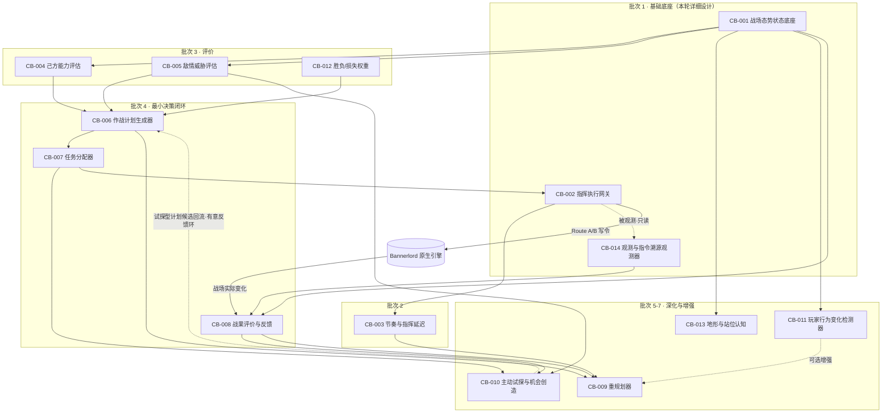
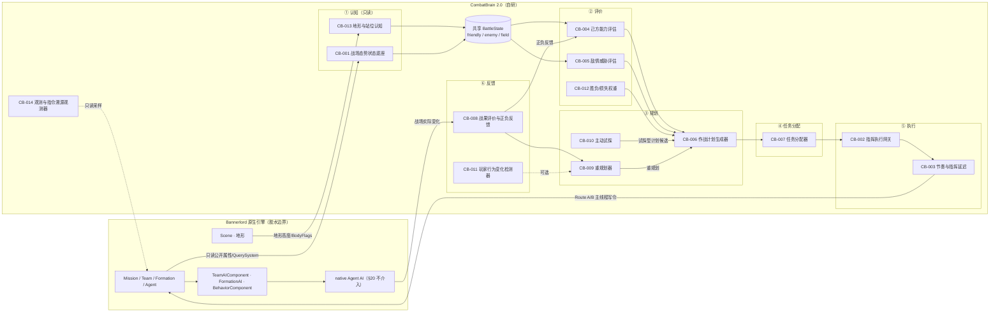

# CombatBrain 2.0 — Feature Decomposition Draft（功能拆解草案 v0.1）

> **文档状态**：Draft / 供评审。本草案只做「Charter → 可独立实现验证的功能单元」的拆解，**不是** CombatBrain 2.0 的完整设计，更不是代码设计文档。
> **单一信息源**：`charter/Charter V0.2.md`。RBM 与原 CombatBrain 1.x 仅作证据，不作需求源。
> **本轮纪律**：禁止修改任何生产代码；未运行任何实机实验。凡需实机才能确认的结论，一律记为 PoC TODO（见 §10），**不得**视为已验证。
> **证据来源**：`Agent/r1-cb-legacy.md`、`r1-code-analyst.md`、`r1-glue-engine.md`、`r1-rbm.md`、`r2-chief-design.md`、`r3-feasibility.md`、`r4-glue-verification.md`（本轮引擎取证）、`r4-asset-audit.md`（本轮资产审计）。
> **证据强度标记**：`[实证·符号]`= 本机 `TaleWorlds.*.dll` 命中符号名（仅证存在）；`[实证·反编译]`= 本机反编译 Mod 源码中的真实调用；`[实证·IL]`= ilscan 反汇编真实 IL；`[实证·源码]`= 已读本机 .cs；`[社区]`= 第三方文档（非本机逐字核验）；`[推断]`= 基于宪章与已知 API 的设计推导；`[未验证]`= 无证据。

---

## 0. 本轮结论先行

1. **Charter 的 27 条被拆解为 14 个候选功能（CB-001…CB-014）**，其中 13 项来自 Charter 明文能力/约束，**1 项（CB-014 观测器）是验证基建**，其存在与否必须接受 §11 审查（见 §11.3）。
2. **全局第一性约束被三重实证确认**：AI 队伍没有、也无法合法获得 `OrderController`（`[实证·IL]`：其构造函数绑定 `Agent owner`；`Team` 仅 `_orderControllers[0]=Master / [1]=Player`）。**所有 Formation 指令只能走 Route A（注入原生 Behavior/Tactic 管线）或 Route B（`SetControlledByAI(false)` + `Set*Order`）**。
3. **可行性判定：无 BLOCKED，但 CB-002 为 PROBABLE**，其 Facing/Arrangement 域残留覆盖未闭合（PoC P1，阻断级）。若 P1 失败且 Harmony Plan B 不可行，则该两域降级为 **BLOCKED**，届时须回到 Charter 重新评估（不强行设计）。
   > 措辞限定：§7.2 的"AI 队无 OrderController"是**三重实证确立的事实**；而"Route A/B 足以完整实现 Charter 的指挥能力"是**当前证据下的判断**，仍受 P1 约束，不得读作"已证完整可行"（审查意见 Q5）。
4. **首批只做 3 个基础功能：CB-001（战场态势状态底座）、CB-014（战场观测与指令溯源观测器）、CB-002（指挥执行网关）**。选择依据见 §5，逐项详细设计见 §6。
5. **旧 CombatBrain 审计结论**：REUSE 8 / ADAPT 7 / REFERENCE 8 / REJECT 14+。**被 r1 判为"REUSE 基座"的 CPS/ATC 治理层，本轮实证显示源码不在本机（仅 dll 残留 `CPS`/`FormationCommandExecutor` 符号，`ATC` 连字符串都没有）→ 下调为 REFERENCE**，CB-002 必须按 Charter 重新实现，不得假设"已有可复用控制面"。

---

## 1. 设计立场与红线（先立规矩，再拆功能）

任何 CB-00X 冲撞以下四条即判定"不该进范围"（§21）：

| # | 红线 | Charter 依据 |
|---|---|---|
| R1 | **通用机制优先**：不为具体战场情形新增专用规则链/独立战术模块。高级行为应由「共享战场状态 + 统一评价 + 作战计划 + 任务分配 + 反馈」少量机制组合产生 | §26 |
| R2 | **绝不进入单兵 Agent 行为层**：只决定 Formation 去哪、承担何任务；单兵如何战斗交给原生 AI。凡触达 `GetOrderPositionOfUnit`、个体格挡/选靶/姿态数值者一律不进范围 | §19、§20 |
| R3 | **不靠数值加成 / 隐藏 Buff / 玩家不可得的隐藏信息**：信息公平落地为"只读公开 `QuerySystem`/`Team`/`Formation` 属性"，不造视野遮挡、不造迷雾 | §3、§14 |
| R4 | **必须有可审计的决策节奏与指挥延迟**，且范围冻结（§21）；不继承旧 T/F/X 代号体系 | §16、§21 |

**顺序纪律（强制）**：Charter → CombatBrain 功能需求 → Bannerlord 能力 → 我们的设计 → RBM / 旧代码仅作参考证据。本文档全程遵守；§8、§9 两章只提供证据，不提供需求。

---

## 2. Phase A — Charter 能力拆解（Feature Decomposition Map）

### 2.1 Charter 条款 → 候选功能映射

| Charter § | 条款要求（摘要） | 派生的候选功能 | 说明 |
|---|---|---|---|
| §1 | 职责限定于军队 / Formation 层级 | —（全局边界） | 不产生 CB，约束所有 CB |
| §2 | 核心目标＝形成并执行合理指挥决策以取胜 | —（元目标） | 指导验收口径，不产生 CB |
| §3 | 不靠数值/隐藏 Buff/隐藏信息 | CB-012 + 全局红线 R3 | 权重用于"不无谓高损耗"，非数值加成 |
| §4 | 建立玩家与 AI 的持续战术博弈 | CB-009、CB-010、CB-011 | 多项能力组合产生，非单一模块 |
| §5 | 己方态势认知（兵力/兵种/职责/优劣/取胜方式） | **CB-001**（**仅数据**）+ **CB-004**（评价） | 数据层与评价层分离。**CB-001 只提供数据，Charter 要求的"认知结论"（优势/弱点/取胜方式）由 CB-004 产出** |
| §6 | 敌情认知（部署/威胁/薄弱方向/无保护单位） | **CB-001**（**仅数据**）+ **CB-005** | 同上。**认知结论由 CB-005 产出** |
| §7 | 作战规划：统一整体作战方案 | **CB-006** | Charter 明文要求"非多个独立局部模块" |
| §8 | 指挥连续性：Plan ≠ Command | CB-006 / CB-007 / CB-002 的**职责边界** | 边界约束，不单独成 CB |
| §9 | 主动权：主动制造战场变化 | CB-010 + CB-006（计划含主动动作） | 不新开"主动权模块" |
| §10 | 试探 → 观察 → 判断 → 利用 | CB-010 + CB-005 + CB-008 | **明确不解耦为"试探独立系统"** |
| §11 | 正向反馈利用：识别并扩大局部战果 | CB-008 + CB-007（扩大战果任务）+ CB-014（观测） | 战果评价属通用评价维度 |
| §12 | 损失控制：行动失效后退出/调整 | CB-008 + CB-012 | 负向反馈走同一套评价，不新开模块 |
| §13 | 重新规划：持续验证计划有效性 | **CB-009** + CB-014（观测前提） | |
| §14 | 信息公平：AI 可获得 RTS 视角等价信息 | **CB-001**（只读公开 API）+ 红线 R3 | 反向约束：禁止造迷雾 |
| §15 | 不主动制造错误 | —（排除项） | **明确排除**"拟人抖动/随机犯错"类功能 |
| §16 | Decision Cadence + Command Latency | **CB-003** | 唯一由该条派生的功能 |
| §17 | 指挥官个性系统暂缓 | —（排除项） | **明确排除**文化/性格/领主特质战术表 |
| §18 | 胜利 50% / 控损 50% | **CB-012** | 共享评价权重 |
| §19 | 职责范围（含**指令冲突处理**） | **CB-002**（唯一仲裁） | "指令冲突处理"是 Charter 明文职责 |
| §20 | 单兵行为属非目标 | —（排除项） | 边界，不产生 CB |
| §21 | 项目范围冻结 | —（流程纪律） | 新增功能须过 §21 四问 |
| §22 | 玩家能识别 AI 的整体作战意图 | CB-006（显式 `objective`）+ CB-007（任务一致性） | 不新开"可解释性模块" |
| §23 | 兵种围绕统一目标协同，非四套独立系统 | **CB-007**（通用任务枚举） | 七类任务：保护/输出/牵制/突破/支援/预备/扩大战果 |
| §24 | 根据玩家行为持续调整计划 | CB-011（**降格为变化检测器**）+ CB-009 | 见 §4.2 降格理由 |
| §25 | 战斗结果主要来自指挥博弈 | —（验收口径） | 约束验收，不产生 CB |
| §26 | 行为能力 ≠ 独立系统 | —（架构纪律） | 约束 CB-006/007/010 不得退化为专用规则链 |
| §27 | 最高层决策循环 | 全局骨架 + **CB-014**（使循环可观测、可验证） | 不要求每步一个模块 |

### 2.2 Charter 明确**不要求**、因此**不得创造**的能力（防范围蔓延）

| 被排除的"看起来该有"的能力 | 排除依据 |
|---|---|
| 视野遮挡 / 未知区域 / 侦察与情报系统 | §14 明文"当前不要求构建" |
| 指挥官个性 / 文化战术表 / 领主特质倾向 | §17 明文暂缓 |
| 单兵微操（格挡/选靶/走位/架枪时机/姿态数值） | §19、§20 非目标 |
| 跨战役记忆 / 玩家习惯建模 | §21 范围冻结（且属旧版已自停的部分） |
| 数值加成 / 隐藏 Buff | §3、§25 |
| 拟人化随机犯错 / 犹豫抖动 | §15 明文禁止 |
| "专用反骑 / 专用护弓 / 专用破阵"等情形规则链 | §26（应先问通用评价机制缺什么） |

---

## 3. Phase B — CB 功能总目录

| 编号 | 名称 | Charter 来源 | 基本目的 | 前置依赖 | 阶段 | 可行性 |
|---|---|---|---|---|---|---|
| **CB-001** | 战场态势状态底座 | §5 §6 §14 §26 §27 | 统一、只读、可刷新的共享战场状态（己/敌/战场），禁止各模块各自读引擎 | — | **批次 1** | **VERIFIED** |
| **CB-002** | 指挥执行网关（唯一出口） | §8 §16 §19 §20 §27 | 把上层决策变成对 AI 队 Formation 的真实指令；唯一仲裁、主线程收敛、租约与安全归还 | CB-001 | **批次 1** | **PROBABLE**（Movement 域 IL 已证；Facing/Arrangement 待 PoC P1） |
| **CB-003** | 决策节奏与指挥延迟控制器 | §16 | 时间门控：规划间隔、计划最小稳定时间、命令生成/传递延迟、编队错峰 | CB-002 | 批次 2 | **VERIFIED** |
| **CB-004** | 己方作战能力评估 | §5 §18 §27 | 在共享状态上形成"当前军队最适合靠何种优势取胜"的高层判断 | CB-001 | 批次 3 | **PROBABLE**（兵种质量 tier 待 PoC P6） |
| **CB-005** | 敌情与威胁评估 | §6 §10 §14 §27 | 识别敌军结构/威胁方向/薄弱方向/无保护单位/有意义目标 | CB-001 | 批次 3 | **PROBABLE** |
| **CB-006** | 作战计划生成器 | §7 §8 §22 §27 | 产出统一 `Plan`（作战目标 objective + 主/辅/保护/突破 + 继续与终止条件） | CB-004、CB-005、CB-012 | 批次 4 | **PROBABLE** |
| **CB-007** | 任务分配器 | §8 §23 §27 | 把 Plan 转译为各 Formation 的通用任务提案（七类任务） | CB-006、CB-002 | 批次 4 | **PROBABLE**（生效依赖 CB-002） |
| **CB-008** | 战果评价与正负反馈 | §11 §12 §13 §27 | 行动后评价结果，输出正/负反馈信号，驱动扩大优势或控制损失 | CB-001、CB-014、CB-002 | 批次 4 | **PROBABLE** |
| **CB-009** | 重规划器 | §13 §24 §27 | 持续验证计划有效性，越过最小稳定时间后触发重规划 | CB-006、CB-008、CB-003 | 批次 5 | **PROBABLE** |
| **CB-010** | 主动试探与机会创造 | §9 §10 §27 | 静态/机会不足时主动制造变化，并通过反馈判断可否扩大 | CB-005、CB-008、CB-007 | 批次 6 | **EXPERIMENTAL**（"敌方会因压力重新部署且我们能观测"这一关键行为未明） |
| **CB-011** | 玩家行为变化检测器（**降格**） | §10 §24 | 检测玩家 Formation 的显著位移/转向/任务变更，作为更新判断的输入 | CB-001 | 批次 7（可选） | **PROBABLE** |
| **CB-012** | 胜负与损失权重 | §18 | 显式 Victory/Casualty 权重与"伤亡"量化公式，供评价与规划共用 | CB-004、CB-005 | 批次 3 | **PROBABLE**（公式待定） |
| **CB-013** | 地形与站位认知 | §6 §9 §13 | 战场状态中补入地形价值维度（高度、站位优劣） | CB-001 | 批次 6 | **VERIFIED**（高度）/ 可行走性子项 **EXPERIMENTAL**（PoC P3） |
| **CB-014** | 战场观测与指令溯源观测器（**验证基建类 CB**，非 AI 行为能力） | §11 §13 §16 §27（验证基座） | 独立于决策栈，逐帧判定"命令来源＝CB／原生／玩家"，记录战场指标时间序列 | —（只读引擎，不依赖任何 CB） | **批次 1** | **VERIFIED**（采样/事件机制）/ **EXPERIMENTAL**（来源分类判别力，并入 P1） |

> **可行性等级定义**：VERIFIED＝已找到明确 API/Native 行为/现有代码证据；PROBABLE＝有明确实现思路但未实机确认；EXPERIMENTAL＝理论可能但关键 Native 行为/API 能力未明需 PoC；BLOCKED＝无可靠途径或游戏不提供该控制能力。
> **本轮无 BLOCKED**；但 CB-002 的 Facing/Arrangement 域存在降级为 BLOCKED 的明确路径，见 §7.2 与 §10 P1。

---

## 4. Phase B — 依赖关系、开发顺序与两项调整

### 4.1 功能依赖图（Mermaid）

**依赖边说明**：实线＝数据流/控制流依赖；虚线＝观测、可选或**回流**关系（不构成硬前置）。

**⚠ 修正（审查意见 Q1，必须修改）**：草案初版曾声称"图中无循环硬依赖"，该断言**不实**。图中存在一条**有意的**反馈环：`CB-006 → CB-007 → CB-010 → CB-006`（试探型计划候选回流到计划生成器）。这是 Charter §27"持续循环直至战斗结束"的结构性结果，不是设计缺陷。为避免实现阶段误以为可无环拓扑排序，在此明确：
- `CB-010 → CB-006` 是**回流边（虚线）**，不构成 CB-006 的硬前置；**CB-006 在完全没有 CB-010 的情况下即可独立闭环**；
- CB-010 仅作为增强项（批次 6）接入；
- 该环由 **CB-003 的计划最小稳定时间**门控防抖，禁止"试探 → 重规划 → 再试探"的高频自激。

除此之外，图中无其他循环边。

### 4.2 对上一轮（r2/r3）的两项修正（本轮独立复核后调整）

| # | 修正 | 原方案 | 修正后 | 理由 |
|---|---|---|---|---|
| 1 | **CB-011 降格** | "敌我意图互建模"（S3 核心，难度最高） | **"玩家行为变化检测器"**，批次 7、可选、不进 MVP | Charter §24 只要求"玩家行为成为 AI 更新判断的重要输入"，**不要求推断正确率**。原方案产物（意图推断质量）无客观验收手段，落入 §21 第 6 问"仅增复杂度未成有效决策能力"。降格后验收标准变为可客观测量的"显著位移/转向/任务变更能否被检出" |
| 2 | **CB-010 与 CB-011 解耦** | CB-010 依赖 CB-011 | CB-010 的"观察结果"**以 CB-008 的战场状态 diff 为主判断源**，CB-011 仅作可选增强 | 否则最高难度且质量未验的模块会成为 CB-010 的硬前置，拖死整条博弈线 |

### 4.3 推荐开发顺序

| 批次 | 功能 | 该批次结束时可观察到什么 | 前置 PoC |
|---|---|---|---|
| **0（非功能）** | — | — | **P1、P2 必须先于 CB-002 落地**（阻断级） |
| **1** | CB-001 → CB-014 → CB-002 | ① 战场态势被一致地读出来且无旧版 ATC-4 类感知 bug；② 每一条 Formation 命令的**来源可被独立判定**；③ AI 队能按 CombatBrain 的指令移动，且不与原生 AI 互相覆盖、玩家接管能安全归还 | P1、P2 |
| **2** | CB-003 | 决策与命令不再每帧刷新，出现可观察的决策间隔与编队错峰响应（§16 生效） | P8、P9 |
| **3** | CB-004、CB-005、CB-012 | 己/敌评价与"伤亡"量化公式定稿，规划层有了统一输入与权衡基准 | P6 |
| **4** | CB-006、CB-007、CB-008 | 最小决策闭环跑通：AI 围绕**一个统一 objective** 组织行动，行动结束后有评价、不自动恢复静态（§11、§22 雏形） | — |
| **5** | CB-009 | 玩家破解当前计划后，AI 明显重新规划（§13、§24） | — |
| **6** | CB-010、CB-013 | AI 能主动制造局部压力；地形维度进入规划 | P3 |
| **7（可选）** | CB-011 | 玩家显著部署变化能被检测并进入判断更新 | — |

> 排序原则（严格按用户给定准则，而非"离最终目标多近"）：**基础依赖优先 → 可独立运行/测试优先 → 可观察结果优先 → 能验证引擎关键设想优先 → 低战略推理依赖优先 → 高复用价值优先**。

---

## 5. 首批基础功能选择依据

候选打分（●＝满足，○＝部分，–＝不满足）：

| 准则 | CB-001 | CB-002 | CB-014 | CB-003 | CB-004/005 |
|---|---|---|---|---|---|
| 是其他功能的基础依赖 | ● 所有认知/评价/规划的输入源 | ● 所有上层决策的唯一落地口 | ● 所有验收与反馈的测量基座 | ○ 仅约束执行层 | ● 规划层输入 |
| 可独立运行 | ● | ●（测试命令注入即可） | ● | –（需先在写令） | ●（纯逻辑） |
| 可独立测试 | ●（离线 mock） | ○（需实机） | ●（离线序列回放） | ● | ● |
| 有明确可观察结果 | ●（快照/overlay/落盘） | ●（Formation 真的动了） | ●（溯源报告） | ●（时序日志） | ○（评价分数，弱） |
| 不依赖复杂战略推理 | ● | ● | ● | ● | –（需领域判断） |
| 能验证 Bannerlord 是否支持 Charter 关键设想 | ○（验证只读信息可得性） | **●（验证"AI 队能否被我们指挥"——全局最关键假设）** | ●（验证命令是否真被原生覆盖） | – | – |
| 后续设计变化时复用价值高 | ● | ● | ● | ● | ○（评价口径会变） |
| **入选** | **✅** | **✅** | **✅** | 批次 2 | 批次 3 |

**为什么不是 CB-003（节奏）先进首批**：CB-003 的实现成本极低且计时原语已 VERIFIED，但它不验证任何引擎关键假设，且节奏参数的标定**依赖 CB-014 的时序数据**。首批内 CB-002 先以"单条命令 + 固定最小间隔门控"的最简形式运行，CB-003 在批次 2 把它参数化、可配置化。

**为什么 CB-014 值得占用首批名额**：旧项目最惨痛的失败是"测量系统自证为伪"——`OrderTrace` 把 CB 内部 `Record` 误标为"原生覆盖"，导致三场实战数据全部作废（r1-cb-legacy §4 教训 2）。**没有独立观测，CB-002 是否真的生效无法被证明**，后续所有功能都建立在不可信的验收之上。CB-014 成本极低（只读 + 落盘）、完全独立、可被离线回归，是典型的"用小能力消除全局风险"。

---

## 6. Phase C — 首批 CB 功能详细设计

### CB-001 — 战场态势状态底座

#### 1. 功能简介

在 Mission 内以固定低频周期，把**双方所有 Formation 的引擎公开状态**聚合成一份统一的只读数据结构 `BattleState`（己方 / 敌方 / 战场三类），供后续所有评价、规划、反馈模块消费，**禁止任何模块各自去读引擎**。

它解决的具体问题：Charter §26 要求"共享的战场状态表示"，而旧版的实际失败正是各 Glue 各算一遍（ATC-4 复审曝出四个 P0：感知刷新失效 / 未知敌算已接敌 / 兵力算两遍 / 预备队误判），"准允投入"建立在假战场上。

**实现后游戏里出现什么以前不存在的可观察行为？**
必须诚实回答：**单独实现 CB-001 不产生任何战场行为变化**。它的可观察产物是工程侧的：
- 战斗中可通过 debug overlay / 日志看到一份实时刷新的战场态势快照（双方各 Formation 的兵种构成、数量、位置、朝向、队宽、凝聚度、敌我关系、地形高度）；
- 任何第三方模块（含 CB-014）读到的是**同一份**带版本号与时间戳的状态，从而"两个模块对战场的理解不一致"这一类 bug 在结构上不再可能。

#### 2. Charter 对应关系

| Charter 条款 | 对应关系 |
|---|---|
| §5 己方态势认知 | 提供兵力/兵种/Formation 位置与职责的结构化原始数据（"认知"结论由 CB-004 给出，不由本功能给出） |
| §6 敌情认知 | 同上，敌方对称可得 |
| §14 信息公平 | **只**读引擎公开 API（RTS 视角等价），不构造视野遮挡、不构造迷雾 |
| §26 行为能力≠独立系统 | 本功能正是 §26 要求的"共享战场状态表示"这一通用机制本身——用它来替代"每个行为自己感知一遍" |
| §27 决策循环 | 循环起点"理解己方 → 理解敌方与战场"的数据基座 |
| §19 | 只读，不写入任何游戏对象，天然不越界 |

#### 3. 功能边界

**负责**：只读采集、聚合、刷新、版本化快照、Formation 稳定标识映射、向订阅者发布刷新事件。
**明确不负责**：
- 不评价、不打分、不判断"优势/弱点/威胁"（→ CB-004/005）；
- 不推断敌/玩家意图（→ CB-011）；
- 不产出计划或任务（→ CB-006/007）；
- 不采集单兵 HP/士气/疲劳（§14 不必要、§20 不越界）；
- 不做视野遮挡与置信衰减（§14 禁止）；
- 不写入任何命令（→ CB-002）。

#### 4. 输入 / 状态 / 输出

**输入**（全部 `[实证·符号]`，多数另有 `[实证·反编译]` 调用样例）：
- `Mission.Teams` → `Team.FormationsIncludingSpecialAndEmpty`（8 槽，含空槽与特殊槽）
- 每个 `Formation`：`CountOfUnits`、`Width`、`Direction`、`CurrentDirection`、`CurrentPosition`、`OrderPosition`、`CachedFormationIntegrityData.DeviationOfPositionsExcludeFarAgents`（凝聚度/离散度）
- `Formation.QuerySystem`：`IsInfantryFormation` / `IsRangedFormation` / `IsCavalryFormation`、`MedianPosition`、`ClosestEnemyFormation`、`ClosestSignificantlyLargeEnemyFormation`
- 兵种统计：遍历 `Formation.Units` / `UnitsWithoutLooseDetachedOnes`，只读 `Agent.Character` / `Agent.Equipment` 归类
- 敌我：`Team.IsEnemyOf` / `IsFriendOf`（**注意自反**：`IsFriendOf(自身)==true`，必须 `if (team == mine) continue` 旁路，`[实证·反编译]` + `[社区]` 双证）
- 时间：`Mission.Current.CurrentTime`（float 秒）
- 地形（可选接入）：`Mission.Scene.GetGroundHeightAtPosition(Vec3, BodyFlags = CommonCollisionExcludeFlags)`、`GetGroundHeightAndBodyFlagsAtPosition(Vec3, out BodyFlags, ...)`（精确签名 `[社区]` TAOM sig dump + `[实证·符号]` 双重确认）

**内部状态**：
- 上一周期快照（供 diff 与增量刷新）；
- Formation → 稳定标识 的映射（槽位索引在战斗中可能复用，必须自行维护稳定 ID）；
- 刷新计时器与刷新版本号 `version`；
- 兵种统计缓存（按 Formation 增量维护，避免每周期全量遍历）。

**输出**：
- `BattleState` 只读快照（含 `version` + `timestamp`），结构为 `friendly[] / enemy[] / field`；
- 事件 `OnBattleStateRefreshed(version)`（经事件总线发布，供 CB-014、CB-008 等消费）；
- 可选：每周期一行 CSV/JSON 落盘（供离线回归）。

#### 5. Bannerlord 落地机制（`[实证]` 以 r4-glue-verification 为准）

| 项 | 结论 |
|---|---|
| 调用/读取的 API | 见上"输入"。全部只读 |
| 控制哪些对象 | **无**（纯只读，不写任何 Formation/Team/Agent） |
| Mission 生命周期阶段 | `OnDeploymentFinished` 建立初始快照；`OnMissionTick(float dt)` 主线程按累积时间门控增量刷新；`OnMissionEnded` 落盘收尾（钩子名均 `[实证·符号]`） |
| Tick 频率 | 建议 2–10 Hz（**非每帧**）；具体值待实测标定，与规模相关 |
| 与原生 AI 冲突 | **无**（只读，无写入竞争） |
| 是否需关闭/绕过原生行为 | 否 |
| 无法控制的 Engine 行为 / 拿不到的信息 | ① 单兵精确 HP/士气/疲劳（§14 本就不需要）；② **"Formation 职责"是 CB 自赋语义**，引擎只给 `FormationAI.ActiveBehavior`（原生当前行为，可作观测但不等于我们的任务语义）；③ 兵种**质量**（tier）属性是否公开可读 → **PoC P6**；④ 干净的可行走性布尔 → PoC P3（属 CB-013） |
| 待验证 | 兵种质量维度（P6）；刷新频率对帧耗时的影响（性能实测，未做） |

#### 6. 实现难度

| 维度 | 评价 | 说明 |
|---|---|---|
| 代码复杂度 | 低 | 纯数据聚合，无算法难点 |
| Native Engine 不确定性 | 低 | 所有读取点均有本机符号/反编译实证 |
| 性能风险 | 中 | 逐 Agent 遍历是 O(N)；需降频 + 增量 + 缓存，禁止每帧全量 |
| 与其他模块耦合度 | 低（被动） | 被所有人依赖，但自身不依赖任何人 |
| 调试难度 | 低 | 输出是可打印的快照 |
| 自动化测试难度 | 低 | 可用 mock Formation 数据做离线纯逻辑回归（复用 CAI/旧版 OfflineTests 工程） |
| 实战验证难度 | 中 | "感知正确性"不能自证（旧版 ATC-4 教训），需 CB-014 + 人工抽样交叉验证 |
| **总体** | **LOW** | |

#### 7. 实现建议（MVP 优先）

1. **MVP**：只读快照 + 固定周期刷新 + 版本号 + CSV 落盘 + 极简 debug overlay（显示双方 Formation 的兵种/数量/凝聚度）。**不做任何评价**。
2. **独立验证四项**（对应旧版 ATC-4 四个 P0，必须由 CB-014 或独立脚本验，不得由本模块自证）：刷新时效、敌我自反判定、兵力去重、预备队（未接敌编队）识别。
3. **instrumentation**：每周期记录 `version / timestamp / 各 Formation 关键字段`，供离线回归。
4. **不做**：评价、意图推断、地形（留 CB-013 接入点，先用中性值）。
5. 复用：`TeamGeometry`（REUSE，`[实证·源码]`）、`SituationVector` 的数据骨架（ADAPT，重定义为通用状态、去掉单兵与迷雾字段）、`CombatEventBus`/`VecMath`/`BufferPool`/`CombatLog`（REUSE）。

---

### CB-002 — 指挥执行网关（唯一出口）

#### 1. 功能简介

把上层（当前是测试驱动器，未来是 CB-007 任务分配）产出的 `CommandProposal`，经过**唯一仲裁**后落地为对 **AI 队伍 Formation** 的真实指令（`SetMovementOrder` / `SetFacingOrder` / `SetArrangementOrder` / `SetFormOrder` / `SetFiringOrder`），并保证：同一 Formation 同一时刻只有一个命令源；命令只在主线程落地；借用控制权时用短租约，玩家接管或阵亡时立即归还。

它解决的具体问题：Charter §19 明文把"指令冲突处理"列入职责，§8 要求 Command 是 Plan 的执行层而不是决策本身；旧版曾出现"命令互刷、靠调用顺序表达优先级、后写者胜"，最终不得不下功能冻结令（r1-cb-legacy §4 教训 5）。

**实现后游戏里出现什么以前不存在的可观察行为？**
- AI 队伍的 Formation 会按 CombatBrain 指定的目标执行移动/朝向/阵型/开火，**而不是**原生 AI 的默认行为；
- 不再出现命令互相覆盖导致的抽搐/抖动；
- 玩家按 F1/F6 接管、或指挥官阵亡导致控制权变更时，AI 侧的租约被干净地归还，不出现"AI 与玩家抢方向盘"。

#### 2. Charter 对应关系

| Charter 条款 | 对应关系 |
|---|---|
| §8 指挥连续性（Plan ≠ Command） | 本功能**只接受命令提案**，不持有战略，从结构上保证"移动/阵型/朝向只是高层计划转化后的执行行为" |
| §19 职责范围（含指令冲突处理） | 唯一仲裁即 Charter 明文要求的"指令冲突处理" |
| §16 指挥延迟 / 可审计 | 命令经队列延时错峰落地；命令落地可被 CB-014 独立观测 |
| §20 不进单兵层 | 只写 Formation 级命令，不触碰任何 Agent 个体 API |
| §27 | 循环中的"按合理节奏执行"环节 |

它如何逼近 Charter 目标：**这是"Charter 设想能否被游戏支持"的判定点**。Charter 全部高级能力（规划、博弈、战果利用）若要产生任何战场效果，都必须经过本网关。因此它先做，不是为了"先出效果"，而是为了**先把全局最关键的技术假设证伪或证实**。

#### 3. 功能边界

**负责**：提案合法性检查、单 Formation 单命令源仲裁、命令落地的 Route 选择（A/B）、控制权租约的借用与归还、主线程收敛、把可被观测的状态暴露给 CB-014。
**明确不负责**：
- **不决定下什么命令**（规划/任务层的职责）；
- 不做战场评价、不做计划、不做试探；
- 不评估"这条命令战术上是否正确"；
- **不评价自己是否成功**（成功与否由 CB-014 独立判定，本模块的日志只能作为被观测对象，不能作为证据——旧版 `OrderTrace` 自证为伪的教训）；
- 不做单兵级修正。

#### 4. 输入 / 状态 / 输出

**输入**：
- `CommandProposal`：`{Formation 稳定 ID, 命令域(Movement/Facing/Arrangement/Form/Firing), 目标值(位置/朝向/阵型枚举), 优先级, TTL, 提案来源模块 ID, 期望生效时间}`
- 控制权边沿：`Formation.IsAIControlled`、`Team.OnFormationAIActiveBehaviorChanged`、`FormationAI.OnActiveBehaviorChanged` 事件
- 计时：`Mission.Current.CurrentTime`、`MissionTimer`（`[实证·符号]` 位于 **TaleWorlds.MountAndBlade.dll**，非 Library——修正 r1 的错误标注）、`MissionTime`

**内部状态**：
- 每 Formation 的当前命令源标识与提案队列；
- 控制权租约：`{是否借用, 借用到期时间, 最短持有时间, 借用者}`（fail-open：到期即归还）；
- 最小写入间隔门控（首批为固定常量，批次 2 由 CB-003 参数化）；
- 待落地队列（用于错峰延时）。

**输出**：
- 对 `Formation` 的 `Set*Order` 实际调用（主线程）；
- 归还事件（租约释放）与拒绝事件（仲裁否决）；
- 可被 CB-014 读取的**外部可观状态**（命令当前值、`IsAIControlled`），**不作为自证材料**。

#### 5. Bannerlord 落地机制

**第一性约束（`[实证·IL]`，已三重证实）**：`OrderController` 的构造函数绑定 `(Mission, Team, Agent owner)`，是玩家发令 UI 控制器；`Team` 只有 `_orderControllers[0]=Master / [1]=Player`；`Team.GetOrderControllerOf(Agent)` 也是按 agent 惰性构造；全本机反编译 Mod 源码中**零处**出现非玩家的 OrderController 用法。**AI 队发令只有两条路**：

- **Route A（软注入，首选）**：`formation.AI.AddAiBehavior(MyBehavior)` + `formation.AI.SetBehaviorWeight<MyBehavior>(w)`（`[实证·IL]`：`_behaviors.Add(arg)`；`[实证·反编译]` RTSCamera/IB 用法）；自定义 `BehaviorComponent` 重写 `GetAiWeight()` 提权，让原生 GOB 选中我们，其 `CalculateCurrentOrder()` 产出的 `MovementOrder` 成为该 Formation 的移动命令。**仅表达 Movement 域**（Facing/Arrangement 不经 Behavior，`[实证·IL]`）。
  - 优点：不抢方向盘，与玩家接管天然兼容（AI 停写即不生效）。
  - 风险：与原生 Behavior 做权重竞争，只能提权不能排他；`OnBehaviorActivatedAux` 激活时会重设全命令（`[实证·反编译]` BetterPikes 对其打 HarmonyPatch，证明方法真实存在）。
- **Route B（硬接管，窄保险丝）**：`formation.SetControlledByAI(false, enforceNotSplittableByAI)`（`[实证·IL]` 证实为**双参**，修正 r1 的单参描述）+ 主线程直接写 `Set*Order`。IL 证实 `SetControlledByAI(false)` 后 `FormationAI.TickOccasionally` 因 `IsAIControlled == false` **早退，Movement 域不再被原生覆盖**。
  - 未闭合：**Facing/Arrangement 在 AI 关闭后是否仍被残留路径覆盖** → PoC P1（阻断级）。
- **兜底 hybrid**：Route A 表达意图；仅关键命令用 Route B 短租约（TTL 1.25–1.5s、最短持有 1.0s、watchdog 到期 fail-open 自动归还、玩家接管立即释放且只归还"自己借来的"）。

| 项 | 结论 |
|---|---|
| 调用 API | `Formation.SetControlledByAI` / `SetMovementOrder` / `SetFacingOrder` / `SetArrangementOrder` / `SetFormOrder` / `SetFiringOrder`；Route A 侧 `FormationAI.AddAiBehavior` / `SetBehaviorWeight<T>` / `TeamAIComponent.AddTacticOption` |
| 读取状态 | `Formation.IsAIControlled`、`FormationAI.ActiveBehavior`、`Mission.Current.CurrentTime` |
| 控制对象 | 仅 Formation 的命令字段（Formation 层，§19/§20 边界内） |
| 生命周期阶段 | `OnBehaviorInitialize` 注册 Route A 行为；`OnMissionTick(dt)` **主线程**执行全部写令与租约维护；`OnMissionEnded` 强制归还全部租约 |
| Tick 频率 | 每帧进入（主线程），但**写令受最小间隔门控**，禁止每帧冲刷 |
| 与原生 AI 冲突 | ① Route A 的权重竞争（GOB 切换，时序参数 `PreserveExpireTime`/`BehaviorPreserveTime` 本轮**未获证实** → PoC P9）；② Route B 的 Facing/Arrangement 残留覆盖（P1）；③ `OnBehaviorActivatedAux` 重设命令；④ 原生 `SetArrangementOrder` 节流（r1 称 0.5s/仅 Scatter，本轮**未核验到** → PoC P8） |
| 是否需关闭/绕过原生 | Route B 需 `SetControlledByAI(false)` 短租约；若 P1 失败，Plan B 为 Harmony 拦 `OnBehaviorActivatedAux`（`[实证·反编译]` RBM/BetterPikes 已证明可行；拦"命令重设"≠改单兵定位数学，**不违反 §20**；本机 `Modules\Bannerlord.Harmony` 已确认存在） |
| 无法控制的 Engine 行为 | 原生每帧 Agent 定位/碰撞数学（`TaleWorlds.MountAndBlade.AutoGenerated.dll`，native）；异步 `doAsyncAITick → TickOccasionally` 在 worker 线程写令（`[实证·符号]`），**我们绝不在此路径写编队** |
| 待验证 | **P1（阻断级）**、P2（玩家接管/阵亡归还边沿）、P4（`SetFacingOrder`/`SetFiringOrder` 精确签名）、P5（`SetControlledByAI` 重载集）、P7（`Team.SetCustomOrderController` 对 AI 队是否有效——存在但生态零使用，不改变 Route A/B 结论）、P8、P9 |

#### 6. 实现难度

| 维度 | 评价 | 说明 |
|---|---|---|
| 代码复杂度 | 中 | 仲裁 + 租约 + 双 Route，逻辑不复杂但状态机易错 |
| Native Engine 不确定性 | **高** | Facing/Arrangement 残留覆盖、`OnBehaviorActivatedAux` 重设、GOB 时序均未闭合 |
| 性能风险 | 低 | 命令写入量极小（每 Formation 每周期 ≤1 条） |
| 与其他模块耦合度 | **高** | 所有上层决策都经它落地；它一旦不稳，上层全废 |
| 调试难度 | 高 | 需要实机 + 观测器才能区分"没生效"与"被覆盖" |
| 自动化测试难度 | 高 | 离线可测仲裁/租约逻辑，但"是否真被原生覆盖"只能实机（P1） |
| 实战验证难度 | 高 | 需要多局、多地图、含玩家接管场景 |
| **总体** | **HIGH** | 且它是全局唯一阻断级风险点 |

#### 7. 实现建议

1. **MVP（验证核心假设的最小系统）**：只做 **Movement 域** + Route A 注入 + Route B 短租约；提供测试驱动器（快捷键/MCM 输入）手动下发一条命令。
2. **PoC 优先**：P1、P2 必须在 CB-002 进入功能开发前完成（批次 0）。P1 的判据＝"接管期间 Facing/Arrangement 无非 CB 写入的跳变"。
3. **debug overlay**：为每个 Formation 显示"当前命令来源（CB / 原生 / 玩家）+ 租约剩余时间 + 是否被覆盖"，颜色区分。
4. **telemetry**：一切结论以 CB-014 为准，本模块不产出"成功率"类指标。
5. **明确首批不做**：Facing/Arrangement 域随 P1 结论决定（若 P1 失败则先只保 Movement）；不做优先级策略（先固定规则）；不做性能剖析（紧随）。

---

### CB-014 — 战场观测与指令溯源观测器（**验证基建类 CB**，非 AI 行为能力）

#### 1. 功能简介

一个**独立于决策栈**的 `MissionBehavior`：按周期采样双方所有 Formation 的命令字段与状态，判定"本帧/本周期的命令来源＝CB 网关 / 原生 AI / 玩家"，并记录战场指标的时间序列，产出可导出的报告与回放数据。

它解决的具体问题：Charter §11/§12/§13 要求"必须对行动结果进行评价""识别正负反馈""持续判断计划有效性"——这一切的前提是**战场变化与命令来源可被观测**。而旧项目的 `OrderTrace` 把模块自己的 `Record` 误标成"原生覆盖"，宣称"原生占 35–80%"，三场实战数据因此全部作废（r1-cb-legacy §4 教训 2）。

**实现后游戏里出现什么以前不存在的可观察行为？**
- 战斗后可导出一份"每个 Formation 每个采样点的命令来源 + 兵力/凝聚度/位置时间序列"报告；
- **原生 AI 覆盖我们命令的事件能被真实检测出来**（旧项目从未做到）；
- 玩家接管、阵亡导致的控制权变更能被记录；
- 同一场战斗中可设置对照编组（一组走 Route B、一组保持原生），直接量化"命令是否生效"。

#### 2. Charter 对应关系

| Charter 条款 | 对应关系 |
|---|---|
| §11 正向反馈利用 / §12 损失控制 | 二者都要求"行动后评价结果"，评价的输入必须来自可信观测 |
| §13 重新规划（持续验证计划有效性） | "有效性"必须可测量 |
| §16 可审计性 | 决策节奏与命令落地需可审计 |
| §27 | 循环中"观察战果及敌方反馈 → 更新判断"环节的测量基座 |

**重要声明（供独立审查员重点核对）**：CB-014 是**验证与遥测基建**，不是 Charter 定义的 AI 行为能力。它进入编号体系的唯一理由是 Charter 的反馈环节（§11–§13）在缺乏可信观测时无法成立，且它是本草案所有验收条件的基础设施。**若审查认为它不构成 Charter 派生需求，应将其降级为"工程工具"而非 CB 功能**——本文档接受该判定，不为其辩护。

> **审查结论（已回填，见 §12）**：独立审查员判定**保留为 CB**，理由是 §11/§12/§13 的反馈环节在缺乏可信观测时无法成立，且它是后续所有功能的验收前置；但**必须标注为"验证基建类 CB"，且可行性拆分为「采样/事件机制 VERIFIED + 来源分类判别力 EXPERIMENTAL」**。本草案已据此修订 §3、§7.1。

#### 3. 功能边界

**负责**：采样、来源判定、记录、导出、回放数据生成。
**明确不负责**：
- 不评价战果、不产生正负反馈结论（→ CB-008）；
- 不修正命令、不参与仲裁、不干预任何游戏对象（纯只读）；
- 不做性能剖析之外的任何行为；
- **不读取、不信任 CB 网关的自述记录**（这是本功能存在的全部意义）。

#### 4. 输入 / 状态 / 输出

**输入**：
- 采样字段（每个 Formation）：`MovementOrder` / `FacingOrder` / `ArrangementOrder` / `FormOrder` / `FiringOrder` 当前值、`IsAIControlled`、`FormationAI.ActiveBehavior`、`CountOfUnits`、`CurrentPosition`、`Direction`、`CachedFormationIntegrityData`、`Mission.Current.CurrentTime`
- 事件订阅（`[实证·反编译]` ImmersiveBattlefields 对 Player/Enemy/Ally 三队均真实订阅）：`Formation.OnAfterArrangementOrderApplied(Formation, ArrangementOrderEnum)`、`Team.OnFormationAIActiveBehaviorChanged(Formation)`、`FormationAI.OnActiveBehaviorChanged`

**内部状态**：环形缓冲（上一采样值 + 时间序列）、对照编组配置、导出句柄。

**输出**：
- 帧/周期级溯源记录：`{timestamp, formationId, 命令域, 旧值→新值, 来源分类, IsAIControlled 边沿}`
- 战场指标时间序列（兵力、凝聚度、位置、敌我距离）
- 报告导出（CSV/JSON）+ 可回放数据（供离线回归）

**来源判定的三层判据（关键设计，避免自证）**：
1. **控制权边沿**：`IsAIControlled == false` 期间发生的命令跳变，不可能是原生 AI 写的（原生 `FormationAI.TickOccasionally` 已早退，`[实证·IL]`）→ 归为"非原生"；
2. **命令形态特征**：由测试驱动器下发"原生不可能产生的命令形态"（例如特定坐标的 Move + 特定 Arrangement 组合），观测器**仅凭 Formation 上的值**即可识别来源，无需信任任何自述；
3. **对照编组**：同场次内 A 组走 Route B、B 组保持原生，两组命令序列的差异即"CB 生效"的直接证据。

> 判据 2/3 的判别力本身需 PoC 验证（并入 P1）。未经验证前，CB-014 的溯源结论只能标注为"推断来源"，不得直接写成"原生覆盖率 X%"。

#### 5. Bannerlord 落地机制

| 项 | 结论 |
|---|---|
| 调用/读取 | 全部只读：Formation 命令字段与公开属性 + 三个原生事件订阅 + `Mission.Current.CurrentTime` |
| 控制对象 | **无** |
| 生命周期阶段 | `OnBehaviorInitialize` 订阅事件（必须在任何 CB 写令之前完成订阅）；`OnMissionTick` 按周期采样；`OnMissionEnded` 导出 |
| Tick 频率 | 采样 5–20 Hz（可配置）；事件为即时触发 |
| 与原生 AI 冲突 | 无（只读；事件订阅为观察型，不改行为） |
| 是否需关闭/绕过原生 | 否 |
| 无法控制的 Engine 行为 | 无法得知"是谁改的"这一元信息——引擎不记录命令作者，只能靠上面三层判据**推断**来源。这是本功能的能力上限，必须在报告中明示 |
| 待验证 | 三层判据的实际判别力（并入 P1）；采样开销（性能实测，未做） |

#### 6. 实现难度

| 维度 | 评价 | 说明 |
|---|---|---|
| 代码复杂度 | 低 | 采样 + diff + 落盘 |
| Native Engine 不确定性 | 中 | 事件与字段均实证存在，但"来源判定"是**推断**，判别力待验 |
| 性能风险 | 中 | 高频采样 × 多 Formation；需降频 + 环形缓冲 + 异步落盘 |
| 耦合度 | 低（旁路） | 只观测，不参与；但所有人都依赖它的结论 |
| 调试难度 | 低 | 输出是可读报告 |
| 自动化测试难度 | **低** | 可用构造的命令序列做离线回放回归（**这是本草案中最容易被自动化验证的功能**） |
| 实战验证难度 | 低 | 只需跑局并导出 |
| **总体** | **MEDIUM**（代码 LOW，但判据设计与性能调校需要谨慎） | |

#### 7. 实现建议

1. **MVP**：逐周期快照 + diff + CSV 落盘 + 极简 overlay（每个 Formation 用颜色标注当前命令来源）。先只做"记录"，不做"报告分析"。
2. **离线回归**：用构造的 Formation 命令序列喂给观测器，验证 diff 与来源分类正确（可完全离线，不需要游戏）。
3. **replay / logging**：复用旧版 `ReplayRecorder` 的环形缓冲机制（ADAPT，`[实证·源码]`），但**剔除**其原有的跨战役记忆消费方（REJECT）。
4. **明确不做**：不评价战果、不给"原生覆盖率"结论直到 P1 闭合。

---

## 7. Bannerlord 可行性分析（汇总）

### 7.1 逐功能可行性判定

| CB | 等级 | 关键证据 | 未闭合项 |
|---|---|---|---|
| CB-001 | **VERIFIED** | 全部只读 API 命中本机符号 + 反编译真实调用样例 | 兵种质量（P6） |
| CB-002 | **PROBABLE** | Route A/B 路径 IL 实证；Movement 域覆盖已证停写 | **P1（阻断级）**、P2、P4、P5、P7、P8、P9 |
| CB-003 | **VERIFIED** | `MissionTimer`（M&B.dll）/ `Mission.Current.CurrentTime` / `MissionTime` 均有符号 + 反编译调用 | 参数标定（需实机） |
| CB-004 | **PROBABLE** | 纯逻辑，输入为 VERIFIED 的公开属性；但"兵种质量"维度依赖 P6 | P6 |
| CB-005 | **PROBABLE** | 同上；`ClosestSignificantlyLargeEnemyFormation` 符号确证存在 | P6；有意义目标的判定属设计问题 |
| CB-006 | **PROBABLE** | 纯决策逻辑，无引擎依赖 | 设计未定型 |
| CB-007 | **PROBABLE** | 逻辑无引擎依赖；生效依赖 CB-002 | 同 CB-002 |
| CB-008 | **PROBABLE** | 观测源（CB-014 + Formation 事件）VERIFIED | 评价口径未定；不得自证 |
| CB-009 | **PROBABLE** | 纯逻辑 | 防抖耦合 CB-003 |
| CB-010 | **EXPERIMENTAL** | 试探动作＝Formation 命令（PROBABLE）；但"敌方会因局部压力重新部署、且我们能观测到"这一关键行为**未有任何证据** | 需先有 CB-008 的 diff 能力，再设计最小试探实验 |
| CB-011 | **PROBABLE**（降格后） | 观测输入（Formation 位置/朝向）VERIFIED | 判定阈值属设计问题 |
| CB-012 | **PROBABLE** | 纯配置/逻辑 | "伤亡"量化公式未定（须在批次 3 定稿，不可留空） |
| CB-013 | **VERIFIED**（主体）/ 可行走性 **EXPERIMENTAL** | 高度 API 精确签名已双证 | **未找到** `IsWalkable` / `GetNavigationMeshFaceIndexAtPosition` 等干净入口 → P3 |
| CB-014（验证基建类） | **VERIFIED**（采样/事件机制）/ **EXPERIMENTAL**（来源分类判别力） | 三个原生事件符号 + 反编译真实订阅代码 | 三层来源判据的实际判别力（并入 P1）；采样开销（性能实测未做） |

### 7.2 全局最关键约束：AI 队无 OrderController

**结论（三重实证）**：AI 队伍没有、也无法合法获得 `OrderController`。

1. `[实证·IL]` `OrderController..ctor` 绑定 `(Mission, Team, Agent owner)`，并写入 `Formation.set_PlayerOwner`——它是**玩家发令 UI 控制器**，语义是"玩家在地图上画命令"；
2. `[实证·IL]` `Team` 的 OrderController 仅 `_orderControllers[0]=Master / [1]=Player` 两个索引；`GetOrderControllerOf(Agent)` 也是按 agent 构造；
3. `[实证·反编译]` 本机全部反编译 Mod 源码中，零处出现非玩家的 OrderController 用法；AI 实际发令路径为 `TeamAIComponent → TacticComponent → BehaviorComponent.TickOccasionally → Formation.SetMovementOrder`，全程不经 OrderController。

> 推论：任何"给 AI 队 new 一个 OrderController"的设想既无社区先例、又违背 owner-Agent 绑定语义、又在 IL 层面无引擎消费方。**Route A/B 是唯一可靠路径**。`Team.SetCustomOrderController` 存在（`[实证·IL]`）但生态零使用，对 AI 队效果归 PoC P7，不改变该结论。

### 7.3 Charter 中"游戏可能无法直接落地"的项与处置

| Charter 设想 | 落地情况 | 缺失什么 | 近似实现 | 牺牲什么 | 是否需改设计 | 是否需 PoC |
|---|---|---|---|---|---|---|
| §5 "各兵种数量与**质量**" | 数量可验；**质量 tier 未验** | `BasicCharacterObject.Tier` 是否公开可读 | 先用数量 + 装备粗分类（可读 `Agent.Equipment`，`[实证·符号]`） | 精度下降；"质量"退化为近似 | 暂不改；若 P6 失败，CB-004 的"质量"维度改为装备派生指标 | **P6** |
| 地形"可行走性"（支撑 §9/§13） | 高度 VERIFIED；可行走性 EXPERIMENTAL | 无干净的 `IsWalkable` 入口 | 用 `BodyFlags` 位推断 + 高度差 | 只能粗判，可能误判水体/障碍 | CB-013 主体不受阻，精细判定延后 | **P3** |
| Facing / Arrangement 域的可靠控制（支撑 §9 部署调整、§23 阵型表达） | **PROBABLE，未闭合** | 不确定 AI 关闭后残留覆盖路径 | Route B 短租约 + fail-open；失败则 Harmony 拦 `OnBehaviorActivatedAux` | 若两者都失败，则朝向/阵型控制不可靠 | 若 P1 失败，需在 Charter 层面评估：§9/§23 的部分表达是否可接受仅由 Movement 域实现 | **P1（阻断级）** |
| "观察敌方反应"（§10、§24） | EXPERIMENTAL | 无任何证据表明敌（玩家）会因局部压力重新部署且可被我们观测 | 先用 CB-008 的战场状态 diff 观察 | "主动诱导弱点"可能长期无法验证 | CB-010 已排到批次 6，且已降低为通用任务的组合产物 | 需最小试探实验（批次 6） |

**纪律声明**：上表第 3 行若 P1 失败，Facing/Arrangement 域判定为 **BLOCKED**。届时**不得强行设计**——必须回到 Charter 评估"仅 Movement 域能否表达 §9/§23 的要求"，并把结论写回本文档，而不是发明替代方案掩盖缺口。

---

## 8. 原 CombatBrain 可复用性审计（REUSE / ADAPT / REFERENCE / REJECT）

> 审计基准：Charter V0.2。**"已经写好了"不构成 REUSE 的理由**。证据强度见 r4-asset-audit.md。

### 8.1 REUSE（8 项：工程基建，零游戏语义）

| 资产 | 证据 | 理由 |
|---|---|---|
| `CombatLog`（缓冲异步落盘） | `[实证·源码]` | 零游戏依赖、零越权，直接搬入 2.0 遥测 |
| `VecMath`（距离/Clamp/对数映射） | `[实证·源码]` | 纯函数 |
| `CombatEventBus`（发布订阅） | `[实证·源码]` | §13/§24 反馈机制基建 |
| `TeamGeometry`（编队中心聚合） | `[实证·源码]` | 只读 `CachedMedianPosition`/`SmoothedAverageUnitPosition` 等公开缓存，纯 Formation 级，无单兵越界 |
| `BufferPool`（`[ThreadStatic]` 对象池） | `[实证·源码]` | 性能基建（2.0 只用编队级槽） |
| `BattleBenchmark`（帧耗时分节） | `[实证·源码·头]` | 性能红线监测 |
| 离线纯逻辑回归工程（旧 OfflineTests / CAI `tests/CAIRegress`）+ `ilscan` + `CaiHarmony` 模板 | `[实证·源码]` | Charter 要求离线测试；ilscan 是查原生 API 的低成本工具（本轮已用它产出 IL 实证） |

### 8.2 ADAPT（7 项：机制有价值，语义需改造）

| 资产 | 证据 | 改造要求 |
|---|---|---|
| `CombatAiMissionLogic`（MissionBehavior 宿主） | `[实证·源码]` | 保留宿主骨架与 Mission/Team/Formation API 用法；**剔除全部单兵 Glue**（含 `defender.EnforceShieldUsage`、`PredictiveBlock`、`FighterProfile`、`DecisionJitter` 逐兵注入） |
| `ReplayRecorder`（环形事件录制） | `[实证·源码]` | 复用录制机制做 CB-014；**剔除**其跨战役记忆消费方 |
| `SituationVector`（12 维向量） | `[实证·源码]` | 复用 struct/索引器骨架重定义为 `BattleState`；去单兵字段、去迷雾字段，**不沿用其"12 维固定含义"作为评价结论** |
| `IntentEngine` 的 `hold_time`/`switch_margin` 防抖 | `[实证·源码]` | **仅保留"最小稳定时间"机制**（转 CB-003）；加权打分选固定意图的逻辑随 TacticManual 一并 REJECT |
| `BehaviorLodScheduler`（决策步长） | `[实证·源码]` | 借阈值模型做指挥节奏；**剔除** `PlayerFocusRadius` 剧场效应包装，自实现距离闸 |
| `TerrainSampler`（开战预缓存查表） | `[实证·源码]` | 复用查表机制（失败降级中性值，"宁缺毋假"）；**剔除**向 KnowledgeView/VisibilityOracle 的迷雾接线 |

### 8.3 REFERENCE（8 项：仅作设计输入或经验参考）

| 资产 | 证据 | 说明 |
|---|---|---|
| **CPS 命令控制面（唯一仲裁 + 硬门）** | dll 含 `CPS`/`FormationCommandExecutor` 符号 `[实证·dll符号]`；**源码不在本机** `[实证·源码·负结果]` | **本轮对 r1 的关键纠偏**：r1 判其"REUSE 基座"，但源码不可得、且 2.0 的约束（Route A/B、短租约、主线程收敛）与旧 CPS 不同 → **必须按 Charter 重新实现为 CB-002**，不得假设已有可复用控制面 |
| **ATC 系列**（命令溯源 / FormationMission 八类 / 命令门控 / 控制权租约） | 仅派单文档；dll **不含** `ATC` 字符串 `[实证·dll符号]` | 纯设计提案，无代码实证。其"控制权租约/命令溯源"思路可作 CB-002/CB-014 设计输入 |
| `OpponentModel`（敌意图信念） | `[实证·源码]` | 概念与 §10/§24 相容，但实现绑定旧意图枚举；CB-011 已降格 |
| `CounterMatrix` / `ExperienceGlue` 的"反馈学习"概念 | `[实证·源码]` | 概念与 §12 相容；具体实现绑定 TacticManual → 随其 REJECT |
| `SurvivalInstinct.CasualtyReformSignal`（编队级重伤脱队统计） | `[实证·源码]` | 概念可作 CB-008 的负向反馈输入参考；逐兵求生部分 REJECT |
| `KnowledgeView` / `VisibilityOracle` | `[实证·源码]` | 作为 **§14 反面教材**（主动让 AI 变瞎，与信息公平冲突） |

### 8.4 REJECT（14+ 项：与 Charter 冲突）

| 资产 | 证据 | 冲突条款 |
|---|---|---|
| `KnowledgeView`（迷雾置信衰减 + 位置噪声） | `[实证·源码]`（注释直书"先让 AI 瞎再谈聪明"） | §14 |
| `VisibilityOracle`（O(格) 可见性 + 地形遮挡） | `[实证·源码]` | §14 |
| `DecisionJitter`（拟人迟疑/犹豫/走形） | `[实证·源码]` | §15（制造错误）+ §16（是 agent 级抖动，不是 Formation 指挥延迟）；其宿主用法直接改单兵举盾 → 双违 |
| `TacticManual`（9 意图 × 12 维权重 + ProtectArcher/BraceFormation） | `[实证·源码]` | §26（专用情形规则链） |
| `CavalryWaveFSM`（骑兵专用多波次 FSM） | `[实证·源码]` | §26 + §23（骑兵应只是承担"突破"任务的 Formation） |
| `Combat/AttackStats` / `FighterProfile` / `PredictiveBlock` | `[实证·源码]` | §20（`defender.EnforceShieldUsage` 直控举盾） |
| `Ranged/RangedBrain`（单兵选靶/弹药） | `[实证·源码]` | §20 |
| `Survival/SurvivalInstinct`（逐兵求生） | `[实证·源码]` | §20 |
| `Experience/CampaignHabits`（跨战役记忆落盘） | `[实证·源码]`（已自停 `_habitsEnabled=false`） | §17/§21 |
| `Enums.IntentType`（9 战术枚举） | `[实证·源码]` | §26 |
| `OpponentModel` 的**具体实现**（非概念） | `[实证·源码]` | §26（绑定旧意图枚举） |
| 旧"靠调用顺序表达优先级"的 Glue 写法 | `[r1报告转述]` | §19（催生命令互刷与冻结令） |

### 8.5 旧版失败教训 → 2.0 强制纪律

| 旧教训 | 转化为纪律 | 复发风险 |
|---|---|---|
| 测量系统自证为伪（OrderTrace） | **强制独立观测**：CB-014 不得读取 CB 自身 Record；禁止在 P1 闭合前给出"原生覆盖率"结论 | **高** |
| ATC-4 四个 P0（感知刷新失效/未知敌算已接敌/兵力算两遍/预备队误判） | CB-001/004/005 共用刷新逻辑须独立验证四项，指标不可自证 | **高** |
| D 组零 Acquire（实验条件过窄） | 对照实验须覆盖真实战场分布，禁止"远出且 Denied 的步兵"式空窗 | 中 |
| 命令互刷催生冻结令 | CB-002 唯一仲裁；废弃"靠调用顺序表优先级" | 低 |
| 整份下发推倒已验证代码 | 先做现状映射再派单（本文档 §8 即现状映射） | 低 |
| 范围蔓延（F13–F25 统帅/观战/导播） | §21 范围冻结 + 不继承 T/F/X 代号 | 低 |
| 个体层空白却占 80% 观感 | 明确接受：§19/§20 的宪章取舍，不是缺陷 | 已接受 |

---

## 9. RBM 对照研究（只作证据，不作需求源）

**顺序纪律**：Charter → 我们的功能需求 → Bannerlord 能力 → 我们的设计 → **RBM 仅作证据**。RBM 从未成为本草案的需求来源。

| RBM 机制 | 本机证据 | 对本设计的价值 | 明确不跟随及原因 |
|---|---|---|---|
| `Team.AddTacticOption` + `AI.SetBehaviorWeight<T>(w)` 软注入 | `[实证·源码]` Tactics.cs:222,457-522 | **印证 Route A 可行**（RBM 同样不持有 OrderController，靠权重让引擎"选中"） | — |
| Harmony 拦 `OnBehaviorActivatedAux` | `[实证·源码]` OverrideBehaviorProtectFlank.cs | **CB-002 的 Plan B 已有先例**，且只拦命令重设、不改单兵定位数学 → 不违反 §20 | 仅作兜底，不作为主路径 |
| `HasBattleBeenJoined` 接战判定 + 两阶段切换 | `[实证·源码]` Utilities.cs:220 | 印证"阶段化"建模思路 | 其用固定权重切换而非统一计划驱动（§8），不跟随 |
| `FindSignificantEnemy` 目标"有意义化" | `[实证·源码]` Utilities.cs:979 | CB-005 采纳"识别有意义目标、不被小股勾走"的**思想** | 其实现是写死兵种类型过滤 → 我们走通用价值评价（§26） |
| 战术层只做兵力分配 + 行为权重、不碰坐标 | `[实证·源码]` Tactics.cs:457-555 | 印证 §8 的 Plan/Command 分层可行 | 其"按文化定制战术表"违反 §17 + §26，不跟随 |
| `Frontline.cs` 逐兵改 `GetOrderPositionOfUnit`(:231) / `GetDirectionOfUnit`(:159)、`OverrideAgent` 改架枪、`StanceLogic`+`PostureDamage` 逐兵姿态↔数值联动 | `[实证·源码]` | 反向证据：证明个体机制确实能显著改变观感 | **全越界** §20；且 §3/§25 要求胜负来自指挥博弈，不得靠个体数值（哪怕非隐藏） |
| 7 RBMBehavior + 13 OverrideBehavior + 6 RBMTactic 按文化/兵种/场景堆积 | `[实证·源码]` 目录实证 | 反面证据 | 恰是 §26 禁止的"大量独立战术模块" |
| `aiDecisionCooldownDict` 单兵决策冷却 | `[实证·源码]` Frontline.cs:909 | 印证限频必要性 | 放在单兵层是错的；我们的节奏在指挥层（§16） |

**RBM 的基准定位**：仅用于标定"强 AI 行为下限"——验证我们只做 Formation 层决策时表现能否不弱于 RBM 行为层。**其单兵机制绝不作为设计来源**（§3、§20、§25）。

---

## 10. 未解决问题 / 需要 PoC 验证的问题

### 10.1 PoC TODO（本轮唯一允许留给未来的实验项；未实施）

| # | 要验证什么 | 为什么现在不能确认 | 最小验证手段 | 判据 | 成本 | 阻塞谁 |
|---|---|---|---|---|---|---|
| **P1** | `SetControlledByAI(false)` 后 Facing/Arrangement 是否仍被原生残留覆盖 | IL 只证 Movement 因 `IsAIControlled` 早退；Facing/Arrangement 改写路径未逐字溯源 | 挂 CB-014 观测器，Route B 接管后逐帧 diff `FacingOrder`/`ArrangementOrder`，观察非 CB 写入的跳变 | 接管期间无外部跳变＝安全；有跳变＝启用 Harmony Plan B | 中（需观测器 + 实机 1 局） | **CB-002（阻断级）** |
| **P2** | 玩家 F1/F6 接管与阵亡的 `IsAIControlled` 控制权边沿 | 事件订阅已证，归还时机未实机闭合 | 订阅 `OnFormationAIActiveBehaviorChanged` + 轮询 `IsAIControlled`，记录接管/归还时刻 | 接管信号在 <1 帧内被捕获并释放租约 | 低 | CB-002 |
| P3 | `BodyFlags` 各位是否对应"可行走/水/障碍" | 位含义未在本机逐字核对 | 在已知地形（桥/河/墙）采样 `GetGroundHeightAndBodyFlagsAtPosition` 对比 | 找到"可行走"判定位 | 低-中 | CB-013 精细判定 |
| P4 | `SetFacingOrder` / `SetFiringOrder` 精确签名与公开性 | 符号在，反编译无调用样例 | ilscan dump `Formation` 对应方法 | 确认签名 | 低 | CB-002 两域 |
| P5 | `SetControlledByAI` 的重载集（1 参与 2 参） | RTSCamera 现两种调用 | ilscan 列举全部同名方法 | 确认重载集 | 低 | CB-002 |
| P6 | `BasicCharacterObject.Tier` 等质量属性是否公开可读 | 未核 | 反编译/ilscan 查可见性 | 能只读拿到 tier＝"质量"可量化 | 低 | CB-004/005 |
| P7 | `Team.SetCustomOrderController` 对 AI 队是否被消费 | IL 见替换逻辑，后续是否被引擎消费未验 | 实机给 AI 队设置后观察是否被引擎调用 | 若不消费＝无关；若消费＝潜在新路径（仍非标准） | 中 | 不改变 Route A/B 结论 |
| P8 | 原生 `SetArrangementOrder` 节流（r1 称 0.5s / 仅 Scatter） | 本轮**未核验到** `ResetArrangementOrderTickTimer` | grep 符号 + ilscan 看方法体 | 确认节流与阈值 | 低 | CB-002 写入频率 |
| P9 | GOB 权重切换时序（`PreserveExpireTime=10f` / `BehaviorPreserveTime=5f`） | 本轮**未核验**字段名 | grep 符号 | 确认存在以设计续权策略 | 低 | CB-002 Route A 续权 |
| **P10** | **最小试探实验：向敌方局部方向施压后，敌 Formation 是否会重新部署、且该变化能否被 CB-014 检出** | Charter §9/§10 的核心假设（"主动制造变化并观察敌方反应"）目前**无任何证据**；这是 CB-010 的命门 | 在 CB-008 具备状态 diff 能力后，用最小代价的局部前压命令做单变量实验，记录敌 Formation 位置/朝向/任务变化 | 敌部署变化可被稳定检出＝CB-010 可进入批次 6；长期检不出＝Charter §10"主动诱导并利用弱点"无法落地，须回 Charter 重新定义该能力边界 | 中（需 CB-001/002/008/014 就位） | **CB-010（阻断级前置）** |
| **P11** | **Route A 正向生效**：自定义 `BehaviorComponent` 注入 + 高 `SetBehaviorWeight` 后，是否被 GOB 选中并真实驱动 Formation 的 MovementOrder | RBM 的 `AddTacticOption` 与 RTSCamera 的 `AddAiBehavior` 是旁证，但"高权重行为被引擎采用并覆写原生 MovementOrder"这条链路未实测 | Route A 注入后，用 CB-014 观测该 Formation 的 MovementOrder 是否等于我们 `CalculateCurrentOrder()` 的产出 | 实测 MovementOrder 被 Behavior 产出接管＝Route A 可用；否则 Route A 仅能作辅助，主路径转 Route B | 低-中 | CB-002（非阻断：MVP 已有 Route B 兜底） |

### 10.2 设计层未解决问题（非 PoC，需后续决策）

1. **CB-012 的"伤亡"量化公式未定**：须在批次 3 定稿（建议 `Formation 剩余兵力占比 × 历史损失速率`），**不可留空**，否则 §18 的显式权重无法生效。
2. **CB-006 的 Plan 语义未定型**：objective 的粒度、继续/终止条件如何表达为可监测谓词，属设计问题，未在本轮定义（本轮只做基础功能）。
3. **CB-010 的验收手段缺失**："主动试探是否产生了机会"如何客观测量，尚未有方案；已在 §7.3 标明为 EXPERIMENTAL，并**已补 PoC P10 作为其进入批次 6 的阻断级前置**。
8. **CB-011"显著变化"的量化阈值与验收用例未定义**：须在批次 7 启动前给出阈值定义与验收用例，否则落入 §21 第 6 问"仅增复杂度未成有效决策能力"（审查意见 Q8）。
4. **CB-014 来源判据的判别力未验**：判据 2/3 能否真实区分来源，并入 P1。
5. **节奏参数初值**：决策间隔、最小稳定时间、Route B 租约 TTL 的初值需实机标定，且与 §16"给玩家反制窗口"耦合（建议以 IB 的 0.8–1.5s 限流为起点）。
6. **RBM 对照实验设计**：如何设计"只做 Formation 层 vs RBM 行为层"的对照，作为下限标定；须避免旧版"D 组零 Acquire"式过窄条件。
7. **CB-001 刷新频率与性能**：2–10 Hz 的建议值未经实测，需帧耗时剖析。

---

## 11. Candidate Architecture（当前阶段候选架构）

### 11.1 候选架构图（Mermaid）

### 11.2 架构由功能需求推导的说明

- **六个分组（认知/评价/规划/任务/执行/反馈）不是预设的"完整 AI 架构"，而是 §27 决策循环的直接映射**：§27 的每一步都至少有一个 CB 承接，且没有一步被拆成多个互不相干的模块。
- **共享 `BattleState` 是唯一的中枢数据结构**，它由 §26"共享战场状态表示"推导而来，不是架构偏好。
- **CB-014 位于栈外旁路**（虚线），因为它不参与决策，只观测——这是旧版"测量自证为伪"教训的直接产物。
- **原生引擎（虚线边界右下）**：§20 规定单兵行为交给原生 AI，因此 `native Agent AI` 明确画在我们栈之外。

### 11.3 尚未确定的架构关系（TBD，不假装已定）

| TBD 项 | 为什么现在不定 |
|---|---|
| 规划层内部是否拆分为「候选生成 / 选择 / 承诺(Commitment)」 | CB-006 尚未进入详细设计；拆分与否取决于 Plan 语义定型（§10.2 问题 2） |
| 评价层是纯函数还是带状态（含衰减/惯性） | 取决于正负反馈是否需要时间平滑，需 CB-008 设计阶段决定 |
| 任务分配是否需要"承诺期"（任务最短持有） | 与 CB-003 的最小稳定时间耦合，待批次 2–4 |
| 多指挥官 / 多 AI 队伍（盟军）场景下的网关作用域 | Charter 未涉及；当前按"每 AI Team 一个网关实例"假设，未验证 |
| 与战役层的关系 | Charter 明确限于战场指挥层，战役层不在范围内（§21） |
| **CB-014 是否保留为 CB 编号** | 已由独立审查员判定（见 §12）：**保留为 CB，但标注为"验证基建类 CB"，非 AI 行为能力；可行性拆分标注**。若后续 Charter 解释变化，可再降级为纯工程工具 |

---

## 12. 独立审查员 Review 与总设计师回应

> 审查员未参与前述任何设计决策。完整报告见 `Agent/r5-independent-review.md`。本章为审查结论摘要 + 总设计师逐条处置。**审查意见未被删改**。

### 12.1 总体判定

**有条件可接受**（严重问题 0 条；中 3 条 Q1/Q2/Q3；轻 5 条 Q4–Q8）。
审查员结论：草案对 Charter 27 条高度忠实、证据引用充分、关键风险处置诚实；**无 Charter 越界、无范围蔓延**；需按"必须修改"项修订后方可分发给实现团队。

### 12.2 问题清单与处置

| 编号 | 严重度 | 问题 | 总设计师处置 | 已落地章节 |
|---|---|---|---|---|
| **Q1** | 中 | 依赖图声称"无循环硬依赖"**不实**：存在 `CB-006 → CB-007 → CB-010 → CB-006` 实线回路 | **接受（必须修改）**。已把 `CB-010 → CB-006` 改为虚线回流边，并显式声明：这是 §27"持续循环"的**有意**反馈环；CB-006 不依赖 CB-010 亦可独立闭环；该环由 CB-003 最小稳定时间门控防自激 | §4.1 |
| **Q2** | 中 | CB-014 整体标 VERIFIED 夸大——其"来源分类判别力"自承未验 | **接受**。改为「VERIFIED（采样/事件机制）/ EXPERIMENTAL（来源分类判别力）」，与 CB-013 写法对齐；名称加注"验证基建类 CB" | §3、§6.2、§7.1、§11.3 |
| **Q3** | 中 | CB-010 核心假设"敌方因压力重新部署且可观测"无任何证据，却未进 PoC 表 | **接受（必须修改）**。新增 **P10 最小试探实验**，列为 CB-010 进入批次 6 的**阻断级前置** | §10.1 |
| Q4 | 轻 | Route A 的**正向**生效（自定义 Behavior 是否被 GOB 选中并真实驱动 Movement）缺专门 PoC | **接受**。新增 **P11**（非阻断，MVP 有 Route B 兜底） | §10.1 |
| Q5 | 轻 | §0"只能走 Route A/B"表述过满 | **接受**。加"在当前证据下"限定，并区分"AI 队无 OrderController（事实）"与"Route A/B 足以实现 Charter 指挥（判断）" | §0 |
| Q6 | 轻 | CB-001 命名易被误读为它交付了 §5/§6 的"认知" | **接受**。§2.1 显式加注"CB-001 仅提供数据，认知结论由 CB-004/005 产出" | §2.1 |
| Q7 | 轻 | §11.3 TBD 未追踪"CB-014 是否保留为 CB" | **接受**。已增一行记录审查判定 | §11.3 |
| Q8 | 轻 | CB-011"显著变化"缺量化阈值与验收用例 | **接受**。已写入 §10.2 作为批次 7 启动前置 | §10.2 |

### 12.3 审查员给出的 12 项逐项结论（摘要）

通过：① Charter 忠实性 ② 技术假设标注（除 Q2） ③ 未把旧 CombatBrain 当标准 ④ 未被 RBM 反向主导 ⑥ 可独立实现验证 ⑧ 真正从基础能力开始 ⑨ 无过度设计 ⑩ 无法落地项处置诚实 ⑪ 架构由需求推导 ⑫ 旧版教训已吸收。
有问题：⑤ 功能规模（实为依赖图断言不实→Q1）、⑦ 编号与依赖（同 Q1）。

**额外必答 1（是否把"应行"写成"已行"）**：点名 2 处（Q2、Q5），均已修订；其余关键处的 VERIFIED/PROBABLE/EXPERIMENTAL 标注与 r4 证据强度一致。
**额外必答 2（PoC 是否覆盖）**：原 P1–P9 覆盖较全，漏 2 项（CB-010 核心假设、Route A 正向生效），已补 P10、P11。

### 12.4 审查员 Top 3 风险（保留，不容忽视）

| # | 风险 | 概率 | 说明 |
|---|---|---|---|
| 1 | **CB-002 的 P1 未闭合**（Facing/Arrangement 残留覆盖） | 中 | 全局唯一阻断级，且批次 1 即依赖。失败则 §9/§23 的朝向/阵型表达降级 BLOCKED，须回 Charter 重评 |
| 2 | **CB-010 核心假设无证据**（敌方会因压力重新部署且可观测） | 中高 | Charter §4/§9/§10 主动博弈的命门；已补 P10，但结果未知 |
| 3 | **文档断言不实 / 标签夸大引发"以为已验证"的连锁误判** | 高（已是缺陷，已修） | Q1、Q2 会让实现阶段高估进度，重蹈旧版 OrderTrace 自证为伪的覆辙 |

### 12.5 审查员认为值得保留的做法

1. §8.3 对 CPS/ATC 由 REUSE 下调 REFERENCE 的纠偏（"源码不在机即不可 REUSE"的硬标准）；
2. CB-014 的独立观测设计（不读 CB 自身 Record，正面消灭自证为伪的坑）；
3. 首批选择 CB-001→CB-014→CB-002 的论证（把"独立证明 CB-002 真生效"列为最高优先级）；
4. 红线 R1–R4 与顺序纪律贯穿全文，§2.2 排除项把"看起来该有"的能力挡在范围外；
5. CB-011 降格判定（避免最高难度未验模块卡死整条博弈线）。

### 12.6 总设计师对审查意见的保留说明

审查意见全部接受，**无任何一条被驳回或软化**。唯一补充说明：Q1 所指的反馈环是 Charter §27 的必然结构（决策循环本身就是环），本草案此前的错误只在"声称无环"，不在"存在环"；已按审查要求改为显式声明 + 虚线表示 + 门控说明。

---

## 13. 变更记录

| 版本 | 日期 | 变更 |
|---|---|---|
| v0.1 | 2026-09-19 | 首版：完成 Phase A/B，选定首批 CB-001/CB-002/CB-014 并完成详细设计；纳入 r4 引擎取证与资产审计结论；修正 r1 的 CPS/ATC 复用判定、CB-011 降格、CB-010 解耦 |
| v0.2 | 2026-09-19 | 依据独立审查（r5）修订：承认并显式声明 CB-006↔CB-010 反馈环（Q1）；CB-014 可行性拆分为「采样 VERIFIED / 判别力 EXPERIMENTAL」并标注为验证基建类（Q2）；新增 PoC P10（CB-010 阻断级前置）与 P11（Route A 正向生效）（Q3/Q4）；§0 措辞加"在当前证据下"（Q5）；§2.1 加注 CB-001 仅提供数据（Q6）；§11.3 追踪 CB-014 判定（Q7）；§10.2 补 CB-011 阈值要求（Q8）。新增 §12 审查与回应章节 |
